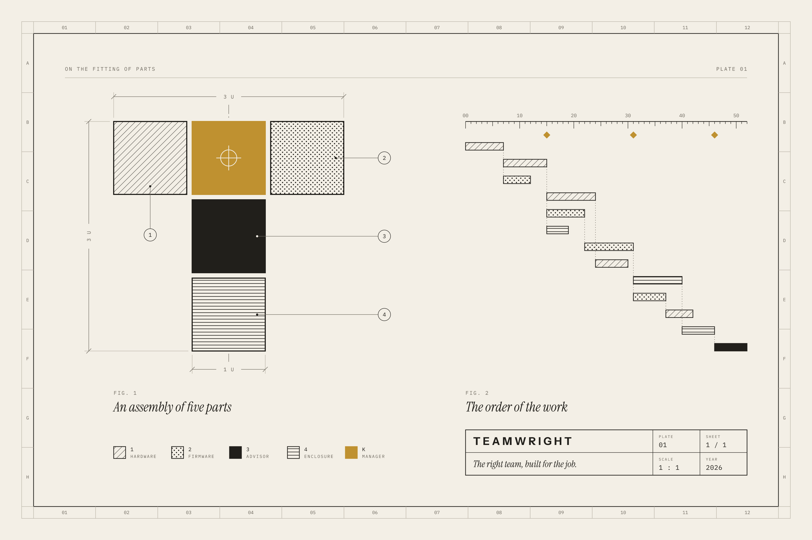
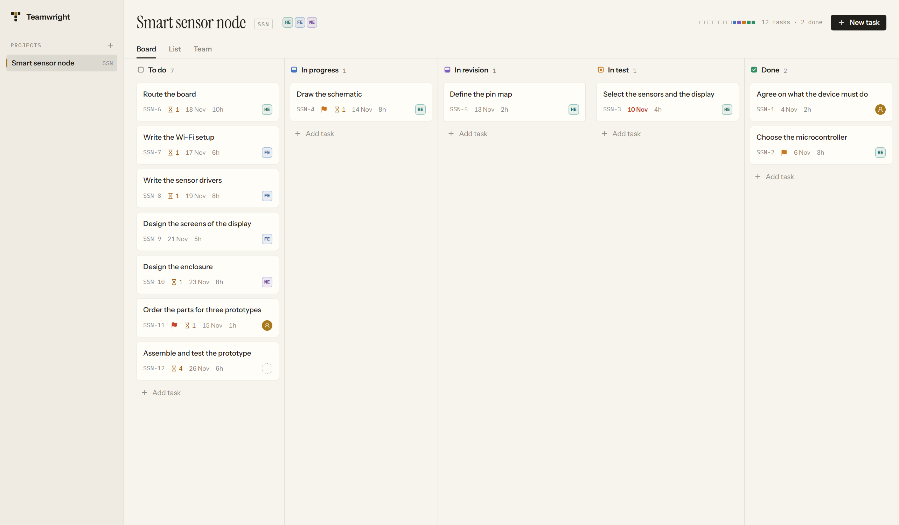
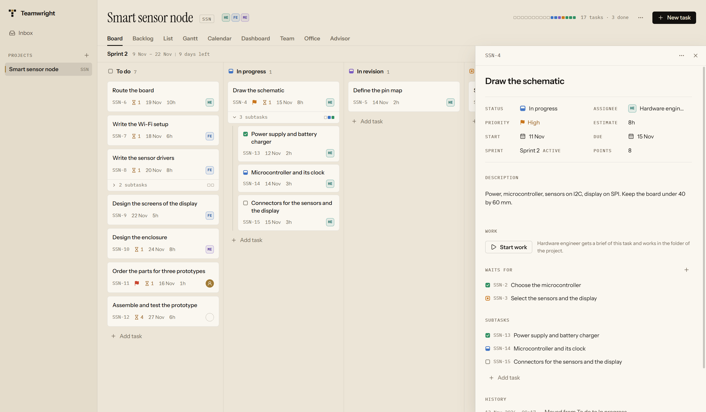
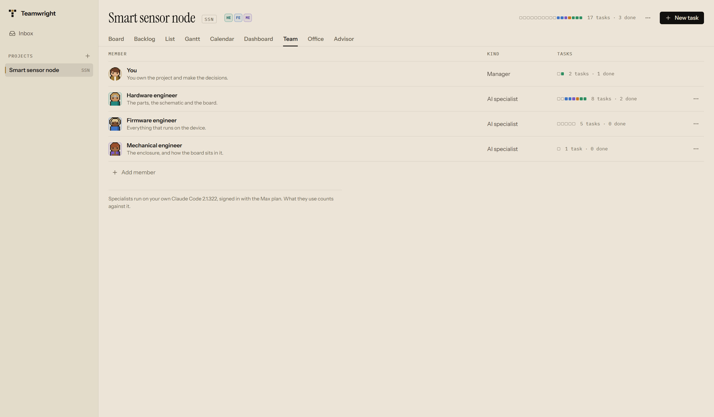

# Teamwright

**You manage. A right-sized team of AI specialists does the work.**

Teamwright is an open-source desktop app for running a project the way a
manager runs a team, where the team members are AI agents working through
[Claude Code](https://code.claude.com/docs) on your own computer.

You explain what you want to build. An **Advisor** interviews you, proposes the
smallest team that can do the job together with a dependency-ordered plan, and
waits for your approval. Then the specialists start working. They move their
tasks across a real project board, hand results to each other, and come to you
with a clear decision request whenever a choice is yours to make.

> **Status: pre-alpha.** The project started on 11 November 2026 and is built
> in the open, one small commit at a time. What works today is the ground
> floor: a desktop app that keeps projects and tasks in a local database,
> shows them on a board and in a list, and lets you put together a team and
> give tasks to its members. The members cannot work yet: the AI team
> described below is the next milestone. There is no installer; the app can
> be [built from source](docs/development/README.md). The
> [roadmap](docs/product/roadmap.md) says exactly what is done.

## What it looks like today

<picture>
  <source media="(prefers-color-scheme: dark)" srcset="docs/screenshots/board-dark.png">
  
</picture>

<picture>
  <source media="(prefers-color-scheme: dark)" srcset="docs/screenshots/task-dark.png">
  
</picture>

<picture>
  <source media="(prefers-color-scheme: dark)" srcset="docs/screenshots/team-dark.png">
  
</picture>

These are pictures of the application as it runs today, on a sample project.
They are [taken from the real program](docs/screenshots/README.md), not drawn.
The specialists in them have names and tasks, and that is all they have so
far: none of them can work yet.

## The problem

AI coding agents are good at tasks. A project is more than a pile of tasks.

Take one engineer who wants to build a small IoT device: a board with a
low-cost microcontroller, a screen, a handful of sensors, Wi-Fi, firmware, and
a printed enclosure. That is at least three disciplines, and they depend on
each other. Firmware needs the pin assignment from the hardware design. The
enclosure needs the board outline and the connector positions. Somebody has to
choose parts, and somebody has to notice when one choice breaks another.

Today that engineer either pushes everything through one long conversation
and loses the thread, or runs several agent sessions by hand and becomes the
message bus between them: copying context around and remembering who is
waiting for what.

Human teams solved this long ago with boards, timelines, dependencies,
sprints, and a manager who makes the calls. Teamwright gives an AI team the
same structure and keeps you in the manager's chair.

## How it works

1. **Brief.** Tell the Advisor what you want, in your own words. Attach
   documents or earlier Claude Code conversations as context.
2. **Interview.** The Advisor asks the questions a good chief of staff would
   ask: constraints, budget, what "done" means, what you have not thought of.
3. **Proposal.** You get a staffing proposal (which specialists, on which
   model and effort level, with what context, and why each one is needed) and
   a plan (tasks, owners, dependencies, estimates).
4. **Approval.** You change what you want and approve. Nothing runs before
   that.
5. **Work.** Tasks start as soon as the work they depend on is finished,
   automatically or when you press start. Specialists publish handoffs for the
   teammates who build on their results.
6. **Decisions.** When a specialist needs a call from you, it arrives in your
   inbox as a decision request: the question, why it matters, the options and
   their consequences, and a recommendation.
7. **Review.** Finished work comes back for your acceptance, with a summary of
   what was done, what was decided, and what it cost in tokens.

You stay able to do everything a manager does in a normal tool: open a task
and assign it, comment, reprioritize, pause a teammate, or ask one of them a
question directly.

## What is different

Teamwright is not the first tool to put AI agents on a board or in a pixel
office. Projects such as Paperclip, Multica, Claw-Empire and Pixel Agents were
there earlier, and the [landscape survey](docs/product/landscape.md) describes
what each of them does. Teamwright exists for a combination we did not find in
one place:

- **Staffing before spending.** An interview, then a right-sized team with a
  reason for every member, then your approval. More agents is not better: the
  Advisor has to justify each one.
- **Project management as the main interface.** Board, list, timeline with
  dependencies, sprints and backlog are where you work, in Scrum, Kanban, or a
  workflow you define.
- **Engineering beyond software.** Hardware, firmware and mechanical work are
  first-class, with handoffs such as pin maps and board outlines between them.
- **Decisions as first-class objects.** Questions for you are structured,
  tracked, and remembered, so no teammate asks the same thing twice.
- **Coordination in code, judgment in models.** Scheduling, dependency
  tracking and message routing are ordinary program logic and cost no tokens.
  Models are used where judgment is needed.
- **Your data, your storage.** Everything lives in a local database. Sync
  between your computers goes through a folder you own, such as Google Drive.
- **A living office.** An optional view shows the team as characters at work,
  with what each one is doing, how long it should take, and what it has used.

## Built on your own Claude Code

Teamwright does not ship a model and does not ask for your Claude password.
It starts the Claude Code program that is already installed on your computer
and that you signed in to yourself, and it talks to it through Claude Code's
documented headless mode. Your skills, plugins and MCP connectors remain
available to the team.

Teamwright is an independent project. It is not affiliated with, endorsed by,
or sponsored by Anthropic. "Claude" and "Claude Code" are trademarks of
Anthropic, PBC.

## Documentation

| Read this | To learn |
|---|---|
| [Vision](docs/product/vision.md) | What the product is for and what it will not do |
| [Landscape](docs/product/landscape.md) | Which similar tools exist and how Teamwright differs |
| [Roadmap](docs/product/roadmap.md) | What is built and what is next |
| [Architecture](docs/architecture/overview.md) | How the pieces fit together |
| [Development](docs/development/README.md) | How to build, run and check the code |
| [Design](docs/design/README.md) | The visual language of the interface and the logo |
| [Decisions](docs/decisions/README.md) | Why each significant choice was made |
| [Story](docs/story/README.md) | The project's history, written for a future film |

## Contributing

The project is young and the foundations are still moving. Issues and ideas
are welcome now; the [contributing guide](CONTRIBUTING.md) explains how the
code is organized and the standards it follows.

## License

[Apache License 2.0](LICENSE).
