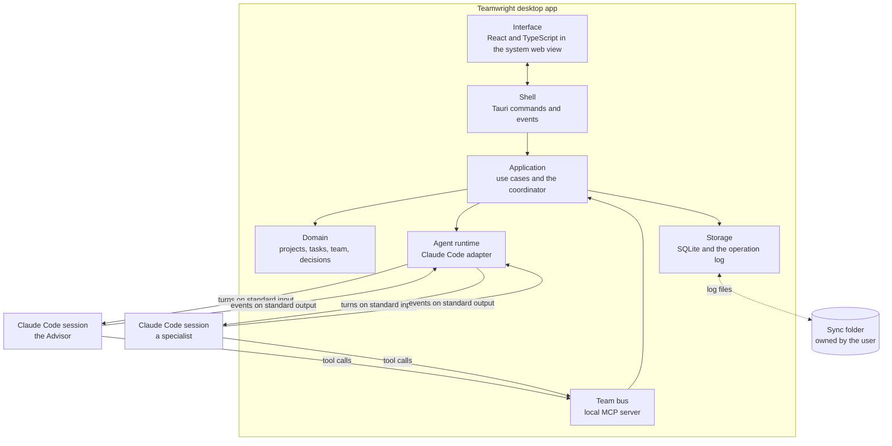
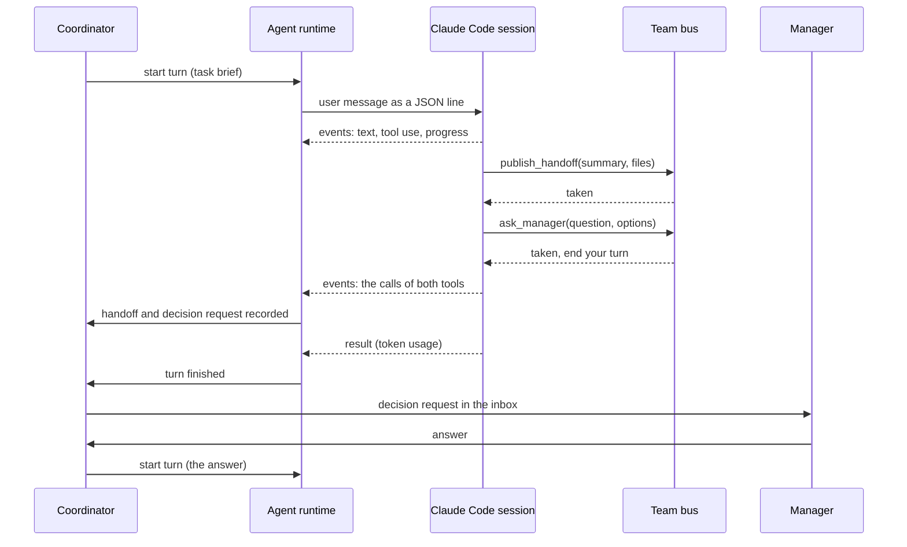

# Architecture overview

This page describes the architecture Teamwright is being built towards. The
[roadmap](../product/roadmap.md) says which parts exist today. The reasons
behind the main choices are in the [decision records](../decisions/README.md).

## The system in one picture

Everything inside the box is one program on the user's computer. The Claude
Code sessions are separate processes that Teamwright starts and stops. There
is no Teamwright server anywhere else.

## Layers and the dependency rule

The backend is a Cargo workspace. Each crate has one job, and dependencies
point in one direction only: towards the domain.

| Crate | Job | May depend on |
|---|---|---|
| `teamwright-domain` | The model and its rules: projects, workflows, tasks, team members, decisions, messages. Pure logic with no input or output. | Nothing of ours |
| `teamwright-application` | Use cases (create a task, approve a plan, answer a decision) and the coordinator. Declares the interfaces it needs from the outside world. | domain |
| `teamwright-storage` | Implements the storage interfaces with SQLite, runs migrations, writes the operation log. | application, domain |
| `teamwright-runtime` | Everything that knows about Claude Code: finding it, starting sessions, encoding turns, decoding events. | application, domain |
| `teamwright-bus` | The local MCP server through which team members reach the application. | application, domain |
| `teamwright-desktop` | The Tauri shell. Builds all the parts, connects them, and translates between the interface and the use cases. | all of the above |

Two consequences are worth stating:

- The domain and application crates can be tested without a database, without
  Claude Code and without a window.
- Replacing SQLite, adding a second agent runtime, or building another front
  end means writing one new crate. Nothing in the domain changes.

## The interface

The interface is a React application written in strict TypeScript. It is
organized by feature (`board`, `timeline`, `advisor`, `inbox`, `office`, and
so on), with a shared design system underneath.

It contains no business rules. It talks to the backend through one typed
interface, `Backend`, which has two implementations:

- `TauriBackend` calls the real application through Tauri commands and
  listens to its events.
- `DemoBackend` runs entirely in the browser with sample data. It is used for
  interface development, for tests, and for a public demo.

## How a team member runs

A team member is a role profile (instructions, model, effort level, tools)
plus a Claude Code session. Starting one means starting Claude Code in
headless mode with that profile and with access to the team bus.

Points to notice:

- **The coordinator is code.** It decides what runs next from the task
  dependencies, the state of each team member, and the budgets. It never asks
  a model.
- **Asking does not block.** A team member that needs the manager records a
  decision request and ends its turn. The process can stop. The answer starts
  a new turn in the same session.
- **The team bus keeps nothing.** It is the Teamwright program itself,
  started a second time by Claude Code for one turn, and it speaks with the
  session over standard input and output. It checks a call and answers the
  session. What the session said reaches Teamwright in the stream of events
  that the agent runtime reads anyway
  ([decision 0012](../decisions/0012-a-specialist-asks-through-a-tool.md)).
  Today the bus has one tool, `ask_manager`. Handoffs and messages are
  planned to travel the same way.
- **Nobody polls.** A team member runs only while it has a turn to work on.
- **Usage is measured, not guessed.** Each finished turn reports its tokens
  per model, which are stored with the turn.

## How team members communicate

Team members do not read each other's conversations. They exchange three
kinds of small, structured things through the team bus:

| Thing | Purpose | Example |
|---|---|---|
| **Handoff** | The result of a task for whoever builds on it: a summary, an interface contract, files. | "Pin map v1: display on SPI2, sensors on I2C0. See `hardware/pinmap.md`." |
| **Message** | A question or a note to one teammate. | "Can the display connector move 3 mm left? It collides with a screw boss." |
| **Decision request** | A question only the manager can answer. | "Battery or USB power only? Battery adds a charger and about 4 mm of height." |

Answered decisions and published contracts become **project memory**, which
any team member can search. This is how the team avoids asking twice and how a
new task starts with what it needs instead of a transcript.

## Data and sync

- Current state is a SQLite database in the application's data directory.
- Every change is also written to an operation log, stamped with the ID of
  the computer and a hybrid logical clock. Every field of every stored thing
  keeps the stamp of the write that set it, and the merged state of each
  thing is kept with those stamps.
- To sync, each computer writes its own log files into a folder the user
  chooses and reads the files of the computers the manager accepted
  ([decision 0017](../decisions/0017-sync-through-a-folder.md)). No file
  ever has two writers, and a file never changes once its name appears.
- What two computers changed is merged field by field: the later stamp
  wins, a counter keeps the larger value, and a deletion is final. Rules
  that span records (one number per task, one key per project, one active
  sprint, no chain of waiting that closes on itself) are repaired after a
  batch is taken in, with ordinary logged changes.
- A conversation belongs to the computer it was started on, where its
  Claude Code session lives. Elsewhere it can be read, not continued, and
  no computer ever ends a turn of another.
- The shell runs a round in the background: its own changes are written
  once they are five seconds old, or at the latest every thirty seconds,
  and the others are read every twenty seconds. The folders of a project
  never leave the computer.
- Deliverables are ordinary files in the project folder: schematics, source
  code, CAD models, documents. Teamwright records where they are; it does not
  hide them in a database.

## Object-oriented design, in each language's idiom

The code follows object-oriented principles the way each language expresses
them.

**Rust**

- *Encapsulation:* a type owns its data and keeps its fields private. It can
  only be created through constructors that enforce its rules, so an invalid
  `Task` cannot exist.
- *Abstraction and polymorphism:* the application declares traits such as
  `TaskRepository` or `AgentRuntime`. Outer crates implement them. Tests use
  in-memory implementations.
- *Composition:* behavior is assembled from small types. Rust has no class
  inheritance and the design does not imitate it.
- *Single responsibility:* one concept per module, one job per crate.

**TypeScript**

- Stateful engines with a lifecycle, such as the office scene, are classes.
- React components are functions with hooks, as is standard for React.
- The backend is reached only through the `Backend` interface.

## Errors

- Domain rules return typed errors; they never panic.
- Each crate defines its own error type and converts the errors of the layer
  below into it.
- The shell maps errors to a code and a message the interface can show.
- `unwrap` and `expect` are for tests.

## Testing

| Layer | How it is tested |
|---|---|
| Domain | Unit tests of every rule |
| Application | Use-case tests against in-memory implementations of its interfaces |
| Storage | Integration tests against a real in-memory SQLite database |
| Agent runtime | Decoder tests against recorded Claude Code output |
| Team bus | Protocol tests that call the tools as a client would |
| Interface | Component and logic tests; the demo backend makes them independent of Rust |

## Security and privacy

- Teamwright never reads Claude Code's credentials and has no sign-in of its
  own.
- The team bus opens no network port. Claude Code starts it for one turn and
  talks to it over standard input and output, and it ends with the turn.
- A team member reaches the folder of its project and the folders the
  manager added for reading, and nothing else on the computer
  ([decision 0011](../decisions/0011-what-a-specialist-may-do.md)).
- Risky tool use by a team member is not approved by Teamwright on the
  manager's behalf. It is forwarded to the manager.
- Nothing is sent anywhere except to Claude Code and, if the user sets it up,
  to the user's own sync folder. Teamwright makes no network connection to
  sync. What goes into the folder is not encrypted in the first version:
  whoever can read the folder can read the projects and the conversations,
  and whoever can write into it can change them. Before the first take-in,
  the database is copied next to itself.
