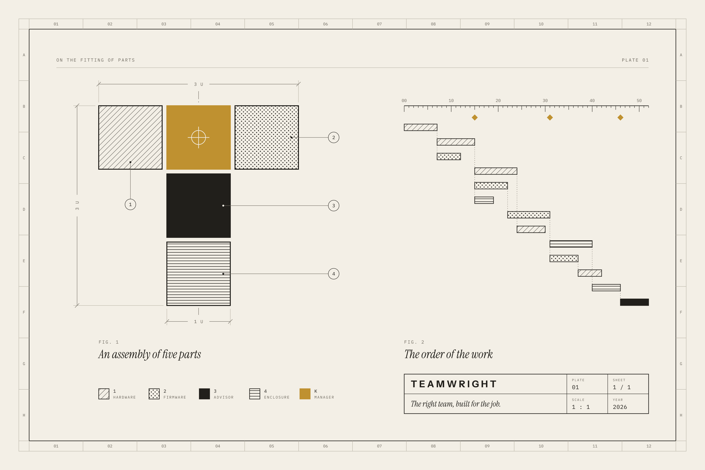

# Design

Teamwright has one visual language for everything it shows: the interface,
the logo, and the pictures that explain it.

| File | What it is |
|---|---|
| [philosophy.md](philosophy.md) | *Joinery*, the design philosophy. Read this first. |
| [key-visual.png](key-visual.png) | *Plate 01*, the key visual: the philosophy expressed on one sheet. |
| [`tools/design/key-visual.mjs`](../../tools/design/key-visual.mjs) | The program that draws the plate. |



## The language in short

- **Parts that fit.** Rectangles on one module, meeting along true lines with
  a constant gap between them. Hairline rules instead of shadows.
- **Paper, night and ink.** Warm neutrals for the ground and the text, in
  the Onyx and Gilded palette: obsidian, parchment and umber.
- **One metal.** A burnished gold marks the single point where the parts
  are held: in the logo it is the keystone, in the interface it is where
  you are. Gold for words is darker on paper than gold for marks.
- **Pigment for meaning only.** Color tells statuses, priorities and people
  apart. Nothing is colored for decoration.
- **Light only where something happens.** A lamp under the pointer, a
  point of light round a card a specialist works on, four gold corners on
  a card that waits for the manager, and a gilded sun on the decision card.
  Each light stands beside a mark or a word that says the same thing.
- **Motion from a small set.** Named curves and durations: arriving slows
  down, leaving speeds up, nothing bounces, and only position and opacity
  move. Reduced motion turns movement into short fades.
- **Three typefaces.** Instrument Sans for the interface, Instrument Serif
  for a single gesture per view, IBM Plex Mono for anything that is counted
  or coded. All three are open fonts under the SIL Open Font License.

The palette and the lights were changed in November 2026, from graphite and
brass to night and gilt, by
[decision 0015](../decisions/0015-light-where-something-happens.md). The
plate below and the screenshots were drawn before that change.

## How the plate reads

*Figure 1* is the logo taken apart: five parts make a T. Three hatched parts
are the specialists, the ink part between them is the Advisor, and the brass
keystone on top is the manager, who holds the others in place.

*Figure 2* is a plan: bars on a scale, each beginning where the bars it waits
for end. The brass diamonds are the moments where the decision is the
manager's.

## Drawing the plate again

```bash
npm install --no-save @resvg/resvg-js
node tools/design/key-visual.mjs <fonts-directory> docs/design
```

`<fonts-directory>` is a folder with the `.ttf` files of Instrument Sans,
Instrument Serif and IBM Plex Mono.
