# User manual

This manual describes what Teamwright can do today. It grows with every
milestone. This version plans and tracks projects, lets the Advisor propose
a team and a plan for you to approve, lets you put together a team
yourself, and lets the AI specialists on it carry out tasks, one at a time.

## Projects

A project holds one piece of work: its tasks and the statuses they move
through.

<picture>
  <source media="(prefers-color-scheme: dark)" srcset="../screenshots/first-run-dark.png">
  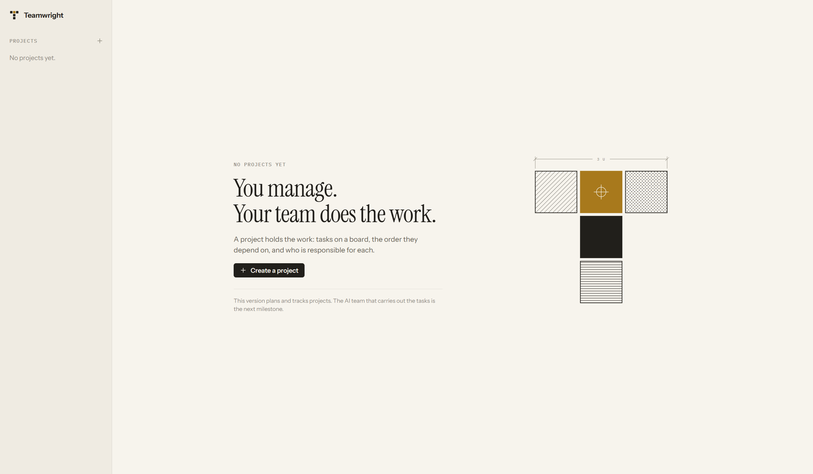
</picture>

**Create a project.** Press the plus sign next to *Projects* in the sidebar,
or *Create a project* on the first screen.

- **Name.** What the project is called.
- **Key.** A short code of two to six letters and digits that prefixes the
  numbers of the project's tasks, as in `IOT-12`. Leave it empty and
  Teamwright derives one from the name: "Smart sensor node" becomes `SSN`.
- **Workflow.** The statuses the project starts with.
  - *Standard:* To do, In progress, In review, Done.
  - *Engineering:* To do, In progress, In revision, In test, Done.

A new project is empty. It opens on the page of the
[Advisor](#planning-with-the-advisor), where it can be planned. The board is
one press away if you would rather add the tasks yourself.

**Switch projects** by choosing one in the sidebar. A small brass line marks
the project that is open. Teamwright reopens the last project you worked in.

**Change a project** from the menu with the three dots in its header.

- *Name and description* opens a form for both. The key stays as it is,
  because it is part of the number of every task.
- *Statuses* opens the list of the project's [statuses](#statuses).
- *Archive project* puts the project away. Nothing is lost: the sidebar
  then shows *Archived* under the list of projects, and from there a
  project is brought back, or deleted.
- *Delete project* removes the project for good, with its tasks and its
  team. Teamwright says what goes with it, and asks first.

### Statuses

The statuses are the steps a task goes through, and the lanes of the
board. A project starts with the statuses of its workflow, and you can
make them your own under *Statuses* in the menu of the project.

<picture>
  <source media="(prefers-color-scheme: dark)" srcset="../screenshots/statuses-dark.png">
  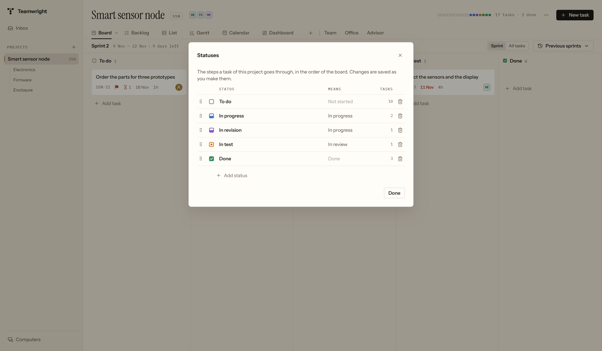
</picture>

Every status has a name, a color, and a meaning. The meaning is one of
four, and it is what Teamwright goes by, whatever the status is called:

| Meaning | What it says about a task |
|---|---|
| Not started | Work on the task has not started. |
| In progress | Work on the task is under way. |
| In review | The work waits to be checked. |
| Done | The task is finished. |

- **Rename** a status by typing over its name. Enter or leaving the field
  saves, Escape undoes.
- **Change the color** with the mark in front of the name, and **the
  meaning** with the word behind it. A status that becomes *Done* finishes
  the tasks in it, and one that stops being *Done* reopens them.
- **Move** a status by dragging the dots at the front of its row. The board
  follows.
- **Add** a status with *Add status*. It appears with the other steps of
  the work, in front of the ones for review and done, with a name ready to
  be typed over.
- **Remove** a status with the bin at the end of its row. If tasks are in
  it, Teamwright asks which status they should go to.

A project always keeps one status in which work has not started and one in
which it is done. The last one of each kind cannot be removed or given
another meaning.

Changes are saved as you make them.

### Folders

*Folders* in the menu of a project says where its specialists work on this
computer, and what else they may read.

- **Work folder.** Here the specialists read, create and change files.
  Teamwright makes a folder for every project. *Choose another folder* lets
  them work somewhere else, for example in a folder that already holds the
  project. What they change there is changed for real. *Use the folder of
  Teamwright* goes back. The work folder cannot change while a specialist
  works in the project.
- **Reference folders.** Folders with material the specialists should know:
  data sheets, an earlier design, a standard. They can read everything in
  these folders, PDF files included, and cannot change anything in them. A
  reference folder cannot be the work folder, lie inside it, or contain it.
- **Reference files.** *Add files* copies single files into the folder
  `references` inside the work folder. The specialists see the copies, and
  nothing else of the folder a file came from.

Teamwright never deletes a folder or a file of yours, also not when you
delete the project. Keep in mind that what a specialist reads is sent to
Anthropic under your account, like everything Claude Code reads.

## Planning with the Advisor

The *Advisor* turns what you want into a team and a plan. It is under the
tab *Advisor* of every project.

**Say what you want.** Write it in your own words: what is to be built, what
you have already, what matters most. The description of the project is
there to start from. Choose the model and the effort the Advisor runs on,
or leave both to Claude Code. Then press *Start planning*.

The Advisor can read the [folders](#folders) of the project and cannot
change anything in them. Give it what it should know there before you
start.

**Answer its questions.** If the Advisor needs to know something before it
can plan, it asks: up to five questions at once, each with the reason it
asks. Where it offers options, pick one. The one it recommends is marked.
Or pick *Something else* and say what you want. A question without options
is answered in words. Press *Send answers* when every question has an
answer. The Advisor may ask a second time.

<picture>
  <source media="(prefers-color-scheme: dark)" srcset="../screenshots/advisor-interview-dark.png">
  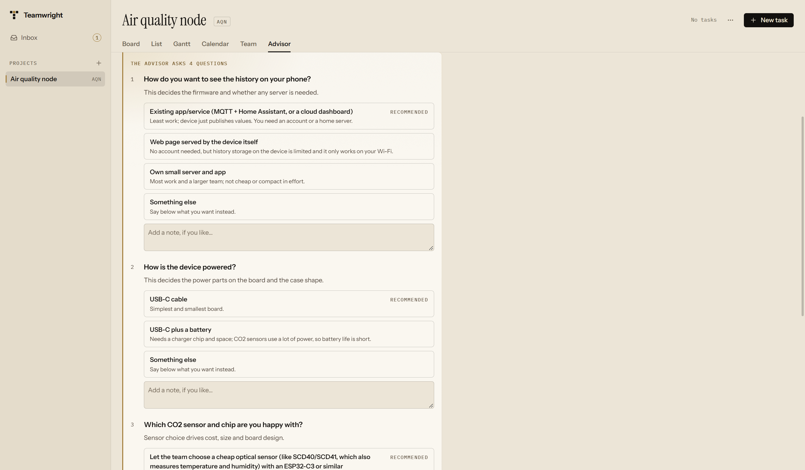
</picture>

**Read the proposal.** The Advisor proposes three things.

- *The project in its words*, for you to check: what is built, what "done"
  means, what is left out.
- *The specialists to add to the team.* Each has what it is responsible
  for, why the project needs it, and the model and the effort it runs on.
- *The tasks.* Each has who does it, its size, and the tasks it waits for.
  Work that needs hands, money or an account is given to you. Press the
  title of a task to read what the Advisor wrote about it.

The size of a task is the Advisor's estimate of the hours a skilled person
would need for it. It says how large the task is. It does not say how long
a specialist takes.

<picture>
  <source media="(prefers-color-scheme: dark)" srcset="../screenshots/advisor-proposal-dark.png">
  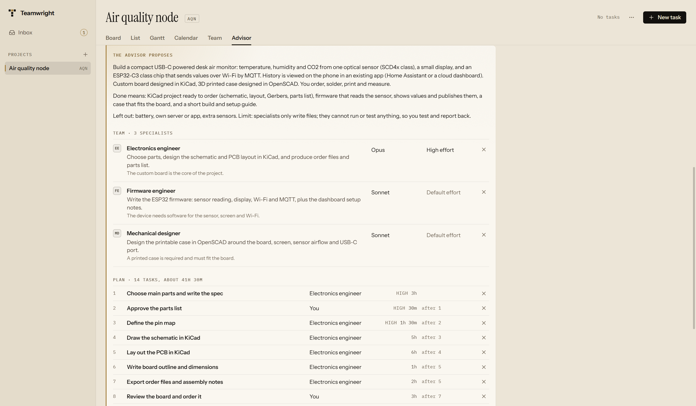
</picture>

**Change it.** The cross at the end of a row takes a specialist or a task
out. Press the owner of a task to give it to somebody else. Press the model
or the effort of a specialist to choose another. The tasks of a specialist
you take out stay in the plan and are given to nobody. *Undo my changes*
brings the proposal back as the Advisor made it. For anything larger, write
to the Advisor under the proposal what to change, and it proposes again.

**Approve it.** Nothing is added to the project before you press *Approve*.
Then the specialists join the team, and the tasks appear in the first status
of the board, each given to its owner. No work starts by itself: you start a
task when you want it started. A specialist the team already has is not
added a second time.

<picture>
  <source media="(prefers-color-scheme: dark)" srcset="../screenshots/advisor-board-dark.png">
  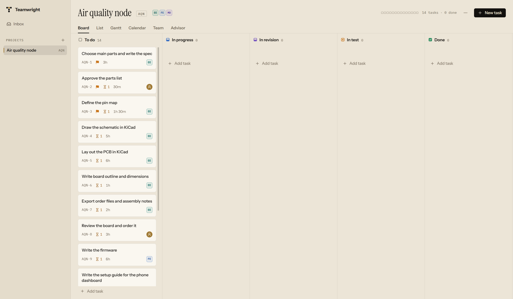
</picture>

**Later.** Write to the Advisor again when the project needs more. It knows
who is on the team and which tasks exist, and proposes what is to be added.
*Plan something new* starts a new conversation.

What the Advisor waits for, answers to its questions or a word about its
proposal, is also counted in [the inbox](#the-inbox).

**What it uses.** The Advisor is a session of your own Claude Code, like a
specialist. Planning takes two or three turns, and they count against your
plan. A lighter model makes a plan too. It will be a plainer one.

## The header of a project

Next to the name of the project are its key and, if the project has a team,
the avatars of the members. Pressing them shows the team.

On the right is a row of small blocks, one for every task, in the color of
the task's status. A hollow block is a task that has not been started. The
count next to it says how many tasks there are and how many are done.

## Tasks

**Create a task** in one of three ways:

- *New task* in the header opens a task by its title and shows it at once, so
  you can assign it and fill in the rest.
- *Add task* at the bottom of a status on the board adds a task to that
  status. The line stays open, so you can type one task after another. Escape
  closes it.
- *Add task* under *Subtasks* in a task adds a part of that task.

**Open a task** by clicking it on the board or in the list. Its panel shows
everything about it:

<picture>
  <source media="(prefers-color-scheme: dark)" srcset="../screenshots/task-dark.png">
  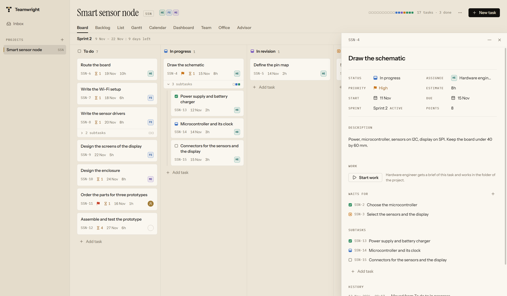
</picture>

| Field | What it is |
|---|---|
| Status | Where the task stands. Choosing another status moves the task. |
| Assignee | Who is responsible: you, a member of [the team](#the-team), or nobody. |
| Priority | Urgent, high, normal or low. Urgent and high show a colored flag. |
| Estimate | The expected working time. Type it as `90m`, `2h` or `1h 30m`. |
| Start, Due | The planned dates. A task cannot start after it is due. |
| Description | Details, acceptance criteria, links. |
| Work | What the AI specialist the task is given to does with it. See [the work of a specialist](#the-work-of-a-specialist). |
| Waits for | The tasks that must be finished before this one can start. |
| Subtasks | The parts of this task. |
| History | What has happened to the task since it was opened, the latest change first: who it was given to, where it moved, which dates it got. |

Changes are saved as you make them. The title, the description and the
estimate are saved when you leave the field or press Enter. Escape undoes an
edit that is not saved yet.

**Delete a task** from the menu with the three dots in the task's panel. Its
subtasks are deleted with it, and tasks that waited for it stop waiting.

### Subtasks

A task can be divided into subtasks, and a subtask can have subtasks of its
own. Add one with *Add task* under *Subtasks* in the panel of the task.

On the board and in the list a subtask is shown under its task, not next to
it. A task with subtasks has a small row that says how many there are, with
one block for each in the color of its status. Press it to unfold the
subtasks, and again to fold them away. Teamwright remembers which tasks you
unfolded.

A subtask has a status of its own, which the mark in front of its title
shows. It stays under its task whatever that status is. To change it, open
the subtask.

### Tasks that wait for other tasks

A task can wait for any number of other tasks of the same project. On the
board, an hourglass with a number shows how many of them are not finished.

Teamwright refuses a dependency that would make tasks wait for each other in
a circle, and says which tasks are involved: *"SSN-1 cannot wait for SSN-3,
because SSN-3 already waits for SSN-1."*

## The team

A project has a team: the help you bring in. A member of the team is an AI
specialist or a person, and a task can be given to either.

<picture>
  <source media="(prefers-color-scheme: dark)" srcset="../screenshots/team-dark.png">
  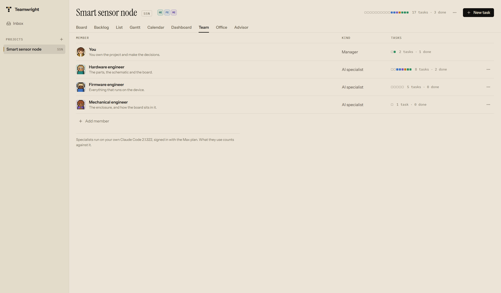
</picture>

**What a member can do today.** An AI specialist carries out the tasks you
give it and answers your questions; see
[the work of a specialist](#the-work-of-a-specialist). A person is a name
that tasks can be given to: Teamwright does not notify them.

**Add a member** with *Add member* at the bottom of the *Team* view.

- **Kind.** *AI specialist* or *Person*. It cannot be changed afterwards.
- **Name.** What the member is called on the team. For a specialist this is
  usually its discipline, as in "Hardware engineer". No two members of a
  team can have the same name.
- **Responsible for.** A sentence about what the member is on the team for.
- **Model** and **Effort.** For an AI specialist: the model it runs on, and
  how hard that model thinks. Both can be left to Claude Code. A lighter
  model and less effort use less of your plan and are enough for plain
  work. You can change them at any time; they hold from the next piece of
  work on. The *Team* view says how each specialist runs.

Teamwright gives every member a color that sets it apart from the others.

**Change or remove a member** from the menu with the three dots in its row.
Removing a member gives its tasks to nobody. Teamwright says how many tasks
that is, and asks first.

**Give a task to a member** by opening the task and choosing the member
under *Assignee*.

**How members are shown.** Where there is no room for a name, a member is
shown by its initials in its color.

| Shape | Who |
|---|---|
| A brass circle | You, the manager |
| A block with initials | An AI specialist |
| A circle with initials | A person |
| A dashed circle | Nobody |

In the *Team* view, the blocks next to a member are its tasks, in the colors
of their statuses.

## The work of a specialist

An AI specialist is a session of Claude Code, the program of Anthropic, that
runs on your computer under your own account. Teamwright starts it, shows
what it does, and keeps the record.

**What you need.** Claude Code has to be installed on this computer, and you
have to be signed in to it. The *Team* view says how that stands: the
version it found and how you are signed in, or what is missing. To sign in,
open a terminal and run `claude auth login`. Teamwright never asks for your
password and never reads how you are signed in.

**Start the work.** Open a task that is given to an AI specialist and press
*Start work*. The specialist gets a brief: the task and its description,
what it is a part of, its parts, the tasks it builds on and how they stand,
when it is due, and what you expect back. The task moves to the first status
in which work is under way.

**Follow it.** The panel of the task shows every step as it happens: what
the specialist writes, and which files it reads and changes. The card of
the task carries a brass mark while somebody works on it, and the *Team*
view says what each specialist is working on. *Stop* ends the work at once.

<picture>
  <source media="(prefers-color-scheme: dark)" srcset="../screenshots/specialist-working-dark.png">
  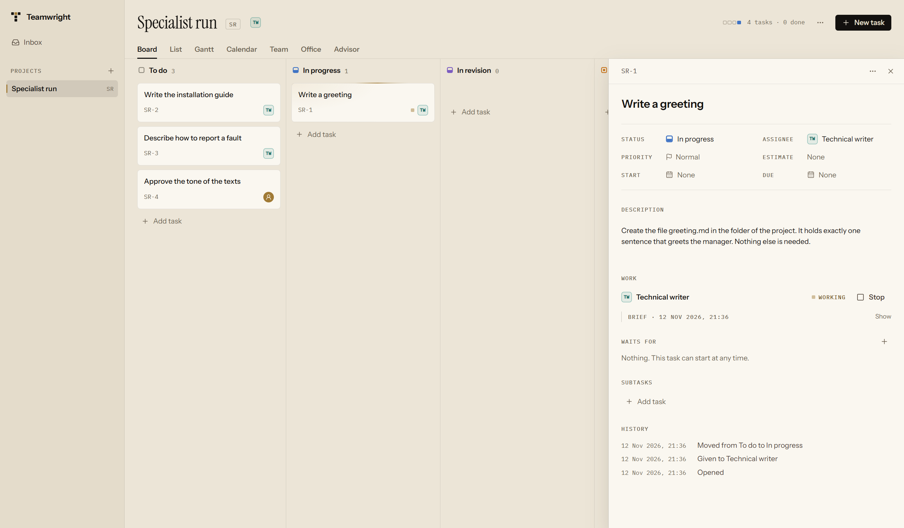
</picture>

**Read the report.** A specialist ends with a report: what it did, which
files it created or changed, what it decided on its own, and what is still
open. The task moves on to the first status in which work is checked. Under
the report are the model, the tokens the turn used and how long it took.

<picture>
  <source media="(prefers-color-scheme: dark)" srcset="../screenshots/specialist-report-dark.png">
  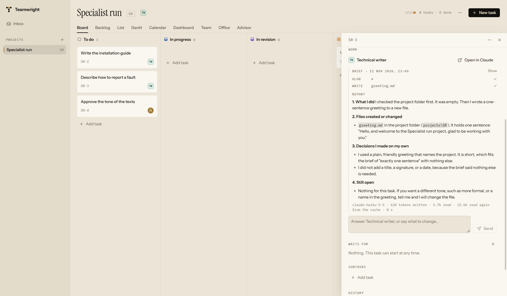
</picture>

**Answer.** Write under the report to accept the work, to correct it or to
ask for more. The specialist goes on in the same session, so it remembers
what it did, and the task goes back into work until it reports again.
Teamwright never calls a task done by itself. That is yours to say.

**When a specialist needs you to decide.** A specialist does not guess at a
choice that is yours: one that changes what is built, what it costs or when
it is ready. It stops and asks. Its question shows in the panel of the task
and in [the inbox](#the-inbox): what it wants to know, why it matters, the
options with what each leads to, and the one it recommends. Pick an option
and add a note if you like, or pick *Something else* and say what you want
in your own words. Then press *Decide*, and the specialist goes on with your
answer. Until then the task stays in work, its card carries a hollow brass
mark, and the specialist is free for other work.

**Ask something.** *Ask something* in the menu of a specialist in the
*Team* view opens a conversation that is not about a task.

**Where the work is.** A specialist works in the work folder of its
project. Unless you choose another one, that is
`Teamwright\<key of the project>` in your documents. What it produces are
files in that folder, yours to open with any program. See
[folders](#folders).

**What a specialist may do.** It may read, search, create and change files
in the work folder of its project, and it may read the reference folders
you gave the project. It cannot run commands, it cannot fetch anything from
the internet, and it can neither read nor change a file anywhere else. It
also does not see what you have set up in your own Claude Code: your
connectors, plugins and settings stay yours. When a task
needs one of these, the specialist says so in its report instead of
working around it.
[Why it is this strict](../decisions/0011-what-a-specialist-may-do.md).

**One thing at a time.** A specialist works on one thing at a time. While it
works it cannot be asked something else and cannot be removed from the team,
and its task and its project cannot be deleted or put away. Stop it first.

**When something goes wrong.** A turn that fails says why in words, for
example that Claude Code is not signed in. Answer it to try again. If you
close Teamwright while a specialist works, the specialist is stopped, and
its turn says so the next time you look.

**What it costs.** A specialist uses your own Claude plan or account,
exactly as if you had used Claude Code yourself. Nothing goes through
Teamwright or its authors.

## The inbox

The *Inbox*, at the top of the sidebar, holds what waits for you in all of
your projects: the questions your specialists asked instead of guessing,
and what an Advisor asks or proposes. The number next to it says how many
there are, and what has waited longest comes first.

<picture>
  <source media="(prefers-color-scheme: dark)" srcset="../screenshots/specialist-inbox-dark.png">
  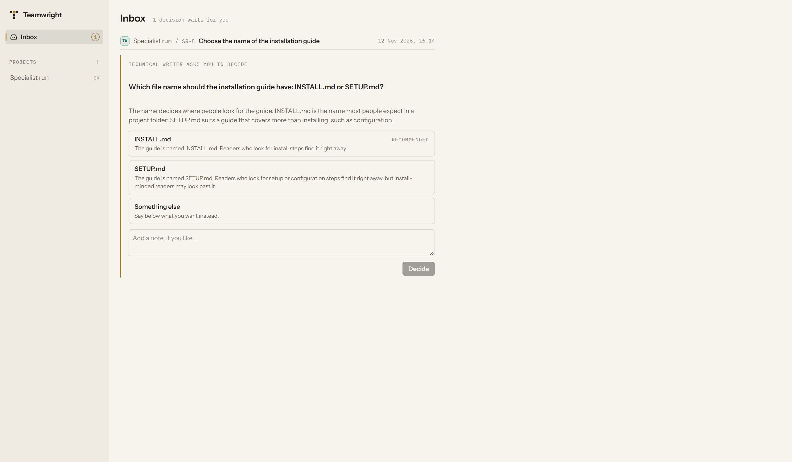
</picture>

Every question of a specialist can be answered where it stands. The line
above it names the project and the task, and the title of the task leads to
it. What an Advisor wants needs more room: *Open* leads to its page.

## Views

**Board.** One lane for every status. Drag a card to another lane to change
its status, or up and down to change its place. An overdue date is shown in
red. The number next to the name of a status counts the tasks in its lane.
[Subtasks](#subtasks) are not counted: they travel with their task.

<picture>
  <source media="(prefers-color-scheme: dark)" srcset="../screenshots/board-dark.png">
  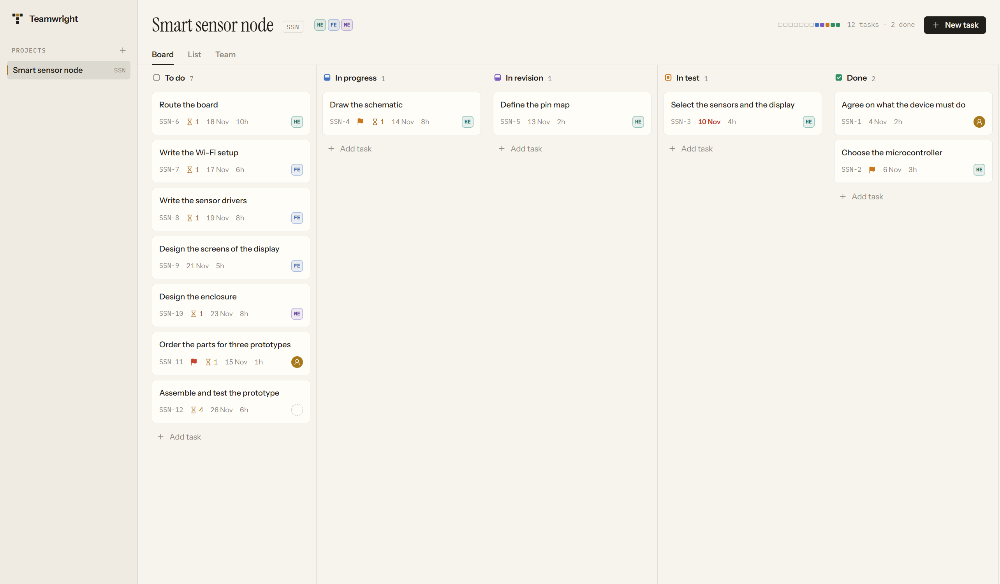
</picture>

**Backlog.** The sprints and the backlog. See
[sprints and the backlog](#sprints-and-the-backlog).

**List.** One table of all tasks, grouped by status, with the subtasks of a
task set in under it.

<picture>
  <source media="(prefers-color-scheme: dark)" srcset="../screenshots/list-dark.png">
  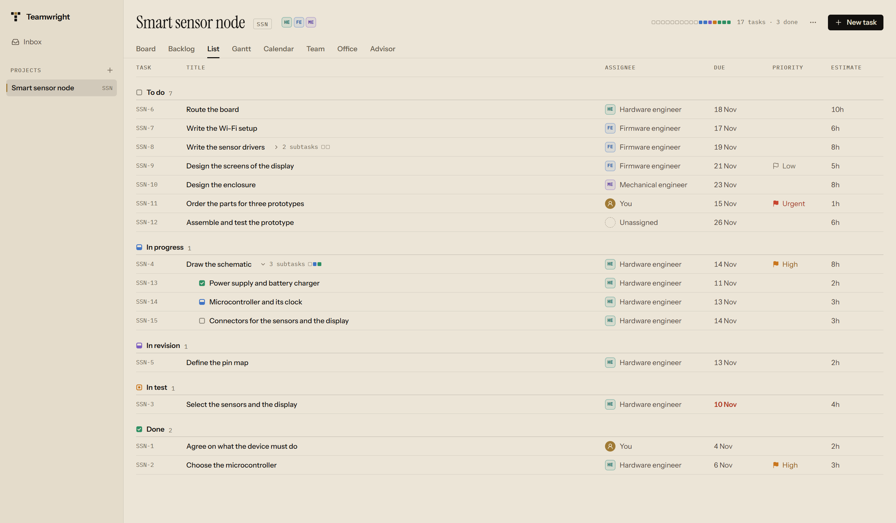
</picture>

**Gantt.** The plan against time: one row for every task, in the order of
the schedule, and a bar from its start to its due date.

- A bar is hollow while the work has not started. It takes the color of its
  status once it has, and is quieter when the task is done.
- A task with only a due date is a small mark on that day. A task with only
  a start fades out to the right. A task without any date has a row and no
  bar.
- A line leads from a task to each task that waits for it. The line is red
  when the dates contradict it: the waiting task begins before the other
  one is due.
- A thin red line behind a bar shows how late the task is. The line in
  brass is today, and *Today* in the corner scrolls back to it.
- Drag a bar to move the task. Drag one of its ends to change only its
  start or only its due date. The new dates are shown while you drag, and
  Escape puts the bar back.
- Press a bar or the name of a task to open it.

<picture>
  <source media="(prefers-color-scheme: dark)" srcset="../screenshots/gantt-dark.png">
  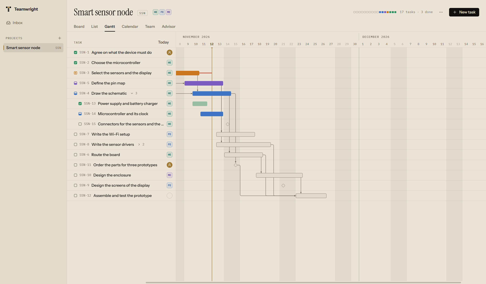
</picture>

**Calendar.** One month at a time. A task lies on the days from its start
to its due date, and a task with one date lies on that day. The arrows go
to the month before and after, and *Today* comes back. A week grows with
what is in it; a day with more than six tasks gets a note such as
*+2 more*, which opens the list of all its tasks. Tasks without any date
are not on the calendar: their number is shown at the top right.

<picture>
  <source media="(prefers-color-scheme: dark)" srcset="../screenshots/calendar-dark.png">
  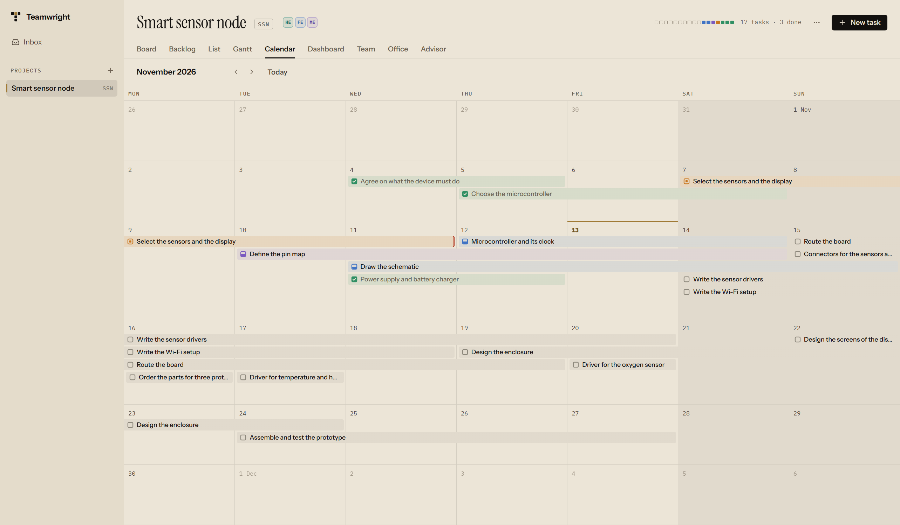
</picture>

**Dashboard.** How the project is going, on one page. See
[the dashboard](#the-dashboard).

**Team.** You and the members of the team, each with its tasks. See
[the team](#the-team).

**Office.** The team at work, at a glance. See [the office](#the-office).

## Sprints and the backlog

You can plan the work in sprints, as Scrum does: a sprint is a stretch of
one to four weeks in which the team works on a chosen part of the
backlog. You do not have to: without sprints every task is in the backlog
and the board shows all tasks, as before.

**The Backlog view** reads from top to bottom: the sprint that runs, the
sprints planned to come, the backlog of everything that is not planned
yet, and at the foot the sprints that are over. Each sprint shows its
name, its dates, its goal, how many tasks and points it holds and, while
it runs, how many days are left. Under it are its tasks: the reference,
the title, who it is given to, its points and its status. Subtasks are
not listed: they go where their task goes.

<picture>
  <source media="(prefers-color-scheme: dark)" srcset="../screenshots/backlog-dark.png">
  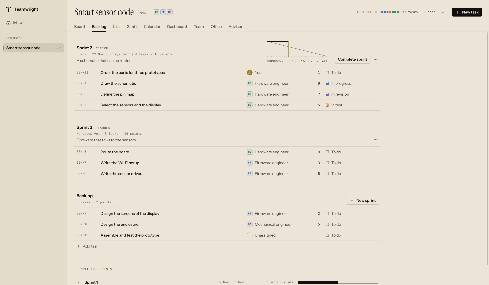
</picture>

- **New sprint**, at the backlog, plans a sprint. Its name may be left
  empty: it is then called *Sprint 4*, after the number of sprints the
  project has had. The goal and the dates can wait until it starts.
- **Plan a task** by dragging its row into a sprint, or back into the
  backlog. Or open the menu at the end of the row (it appears when you
  point at the row or reach it with Tab) and choose *Move to*. A completed
  sprint takes no more tasks.
- **Story points** say how big a task is compared with other work: a whole
  number from 0 to 999. Click the points in a row to change them, or
  change them in the task's panel. They stand next to the estimate in
  hours, which stays what it is.
- **Start sprint** asks for the name, the goal and the dates. It offers
  today and two weeks later; the keys *1 week*, *2 weeks* and *4 weeks*
  set the end in one step. A sprint needs at least one task to start, and
  only one sprint runs at a time.
- **Complete sprint** says how many of its tasks are finished, and asks
  where the unfinished ones go: to the backlog or to a planned sprint.
  Their subtasks go with them. The finished tasks stay in the sprint as
  its record. A task is finished when its status is of the kind *done*,
  whatever the status is called.
- The menu of a sprint changes its name, goal and dates, and deletes a
  sprint that has not started; its tasks go back to the backlog. A sprint
  that runs cannot be deleted, and a completed one cannot be changed.

**The burndown chart** stands next to the sprint that runs. The thin line
falls from all the work of the sprint on its first day to none on its
last: the pace its dates ask for. The ink line is what really remained at
the end of each day, in points if any of its tasks has points and in
tasks otherwise. The brass line is today. The chart counts the tasks that
are in the sprint now, as if they had been there from the first day: a
task added in the middle raises the line from the start, and a task taken
out leaves no trace. It does not yet follow such changes day by day.

**Completed sprints** keep what they took on and what they finished:
*13 of 15 points*. The bar beside it shows the same on one scale for all
of them, so you can see the pace from sprint to sprint.

Press the line of a completed sprint to open it where it stands, and press
it again to fold it. Opened, it shows its goal, its dates, when it was
started and completed, what it took on and what it finished, its burndown
as it ended, and its tasks. The tasks in it are the ones it finished:
the unfinished ones moved on when it was completed, and the program does
not keep which they were, so it only says that some did. Press a task to
open it. The rows cannot be dragged or moved, and their points cannot be
changed: the sprint is over.

**The board** shows the tasks of the sprint that runs. The switch at the
top right, *Sprint* and *All tasks*, shows every task again. A task you
add on the board of the sprint goes into the sprint.

*Previous sprints*, next to the switch, lists the sprints that are over.
Choose one and the board shows the tasks it finished. The header names the
sprint, says that it is completed and gives its dates and its result. The
key at its right, *Back to* the sprint that runs or *Back to all tasks*,
leads back. A task you add while a previous sprint is shown is not put into
it, because a completed sprint takes no tasks. Without a running sprint the
board shows all tasks, and *Previous sprints* is there as long as one sprint
is over.

**The task's panel** shows the sprint of the task and lets you move it to
another, or to the backlog, and shows its points.

## The office

The *Office* tab draws your project as a workshop seen from above. You and
the Advisor sit at the front of the room, where the plan is made. Every
member of the team has a bench on the floor. Each place has a reference on
the edge of the drawing, such as *B2*, and the arrangement follows from the
size of the team and of the window: you do not arrange it.

<picture>
  <source media="(prefers-color-scheme: dark)" srcset="../screenshots/office-dark.png">
  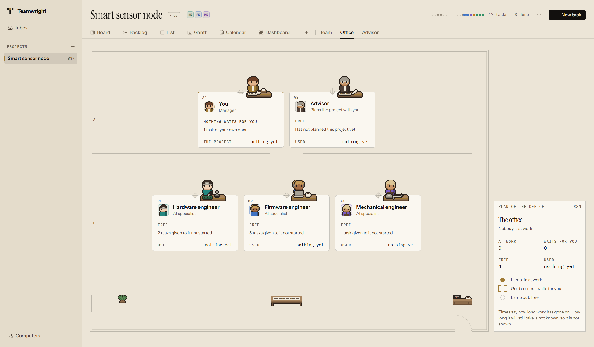
</picture>

A lamp hangs over every bench. It is lit only where a specialist or the
Advisor is working. A bench that waits for you is held by four gold
corners, like a waiting card on the board. The words on the bench always
say the same as the light, so the office reads in a picture and with
motion turned down too.

<picture>
  <source media="(prefers-color-scheme: dark)" srcset="../screenshots/specialist-office-dark.png">
  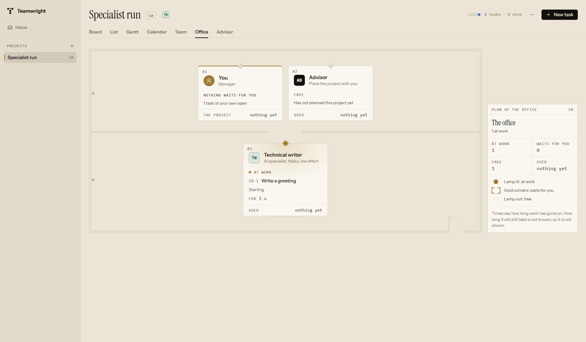
</picture>

| What the bench says | What it shows |
|---|---|
| *At work* | The task, or *A question of yours*; the last thing done, such as *Reads README.md*; how long the work has gone on, counted as you watch; and the size of the task, if it has one |
| *Waits for you* | The task, and the decision it asks of you. For the Advisor: its questions, or its proposal |
| *Free* | How many of the tasks given to it have not started |
| *Person* | How many of the tasks given to them are not finished |

The last line of a bench is what that specialist, or the Advisor, has used
in this project so far, in tokens. On your own place it is what the whole
project has used, and the line above says how many things wait for you.
A turn's tokens are known only when it ends.

The office shows no time left. Teamwright does not know how long a task will
still take, so it shows how long the work has taken so far and the size you
gave the task, and nothing it would have to guess.

**Press a bench** to go on: a specialist at work or waiting opens its task,
or its conversation when the work is a question of yours; a free specialist
opens a conversation; the Advisor opens its page; your own place opens the
inbox. With the keyboard, Tab moves from bench to bench and Enter presses.

The title block in the corner counts the room, and its legend says what the
lamp and the corners mean.

### The people in the office

Every place has its person: a figure drawn in pixels, sitting at a desk
of wood above the bench, the bench itself below like a label. In a wide
window the figures are drawn larger than in a narrow one. You can tell
what each does by what it wears and what stands on its desk:

| Character | Wears | On the desk |
|---|---|---|
| You, the manager | A gold jacket | A tray of letters and a mug |
| The Advisor | A long dark coat, gray hair, glasses | The plan, and rolled plans |
| Software or firmware | Headphones | A laptop and a mug |
| Hardware or electronics | A loupe on the forehead | A circuit board and a soldering iron |
| Mechanical | An apron | A machined part and a caliper |
| Designer | A beret | A drawing tablet and a fan of colors |
| Test | A lab coat | An instrument and a clipboard |
| Technical writer | A cardigan | A notebook, a pen and books |
| Researcher or analyst | Glasses and a sweater vest | Papers, a magnifying glass and a chart |
| Anybody else | A shirt | Papers and a mug |

Teamwright chooses the character from the words of a member's name, or,
if the name says nothing it knows, from its responsibility: *Firmware
engineer* and *Embedded developer* both get the software character. A
person on the team gets a character the same way. The shirt is in the
member's own color, and the skin and the hair are the member's own, so two
members with the same role look different, and each looks the same every
time you come back. The same face stands next to the name on the bench
and in the Team view.

The people do what their bench says. At work, they bend over the work and
their things move: smoke rises from the soldering iron, the screen lights
up. Waiting for you, they sit turned to the room with a hand raised,
inside the gold corners. Free, they sit at ease and now and then do a
small thing: look around, take a sip from a cup, turn a page, stretch.
Now and then one gets up, walks along the aisles to the nearest of the
window, the table with the plan or the coffee corner at the foot of the
room, stays a while, and walks back. While they are away, their chair
and their things wait on the desk. You and the Advisor do the same. As
soon as work starts for somebody who is away, they turn round and come
back. If you make the window wider or narrower, whoever is on the way
walks on in the new room.

It is calm on purpose: one person at a time is on the way, and one is
away from the desk, or two in a team of six or more. Nothing moves while
the window is hidden. If your system asks for less motion, nobody walks
and nothing moves: everybody sits at the desk in the pose of what the
bench says.

## The dashboard

The *Dashboard* tab says how the project is going, on one page that reads
from top to bottom. There is nothing to set up.

<picture>
  <source media="(prefers-color-scheme: dark)" srcset="../screenshots/dashboard-dark.png">
  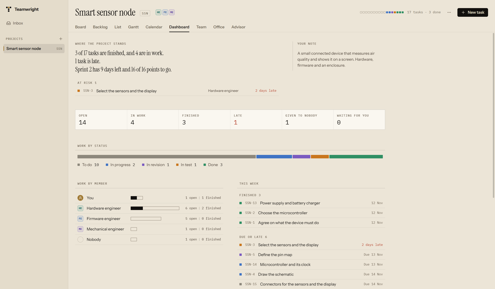
</picture>

**Where the project stands.** A few short sentences at the top, such as
*5 of 21 tasks are finished, and 4 are in work. 1 task is late. Sprint 2
has 9 days left and 16 of 22 points to go. 1 thing waits for you.* They are
worked out from your tasks, sprints and conversations by fixed rules, so
opening the page costs no tokens. A sentence with nothing to say is left
out. Under them, the tasks **at risk** are named: those that are not
finished and are past their due date. Press one to open it.

**Your note.** Beside the summary stands the description of the project,
as the note you keep about it. Write in it where it is; it is saved when
you leave the field, and Escape puts back what was saved.

**The numbers.** Open, in work, finished, late, given to nobody, and
waiting for you. *Finished* counts the tasks in a status that means done,
whatever you called it; *in work* those in a status that means the work
goes on or waits to be checked. *Waiting for you* opens the inbox, and is
held by gold corners while anything waits.

**Work by status.** One bar with a part for every status, in the order of
your workflow and in its colors, with the name and the count of each
under it.

**Work by member.** For you, every member and the tasks given to nobody:
a bar of what is given, filled in as far as it is finished, with the
numbers after it.

**This week.** What was finished since Monday, and what is due by Sunday
or already late. Press a line to open its task.

**The sprint.** For a project that uses sprints: the running sprint with
its dates, its goal and its burndown, and the completed sprints with what
each took on and what it finished. *Open the backlog* goes to the Backlog
view.

**Usage.** The tokens the Advisor and every AI specialist have used in
this project, and the project as a whole. A person uses none and is not
listed. A turn's tokens are counted when it ends.

A project without tasks, without sprints or without a team says what is
missing in a sentence and leaves those parts out. The dashboard does not
show what Teamwright does not know: the limits of your plan, how long
anything will still take, or a list of the latest changes.

## Several computers

You can work on your projects from more than one computer: a desk at home
and a laptop, for example. Teamwright keeps them in step through a folder
that you own and that every one of them can reach, such as a folder that a
cloud drive keeps in step. There is no account and no server: each computer
writes what changed into that folder, and takes in what the others wrote.

**Starting.** *Computers*, at the foot of the sidebar, is where syncing is
set up. *Choose a folder* opens the folder window of your system. Then
Teamwright asks for the name of this computer, with the name the system
gives it filled in. The name is written into the folder, where your other
computers show it. The name the system gives a computer often holds your
own name, so you may want one that only says which computer it is, such as
"Desk". *Keep in step* starts. Do the same on your other computer, with the
same folder.

**A new computer.** When another computer first writes into the folder, it
appears under *Other computers* with *Take in* and *Ignore*, held by the
gold corners of something that waits for you, and the line at the foot of
the sidebar says that it waits. *Take in* brings in its projects and its
work, and from then on everything it changes. *Ignore* takes in nothing of
it; you can change your mind with *Take in after all*. This is so that two
libraries of projects are never mixed up by mistake.

**The line at the foot of the sidebar** says how syncing stands, in words:
*In step* and since when, *Writing to the folder*, *The folder cannot be
reached*, or *Stopped* with the reason. It turns gold only when something
is wrong or waits for you. Pressing it opens *Computers*.

**On Computers** you see the name of this computer, which you can change by
clicking it; the folder, with *Stop syncing*; when the last round was, with
*Sync now* to run one at once instead of waiting; and the other computers,
with their version of Teamwright and when they were last heard from. A
quiet line under a computer says when its clock is more than five minutes
ahead of this one, or when it runs a newer Teamwright whose files this one
cannot read yet. Stopping removes nothing from the folder; choosing it
again goes on where it stopped.

**What you are told.** Now and then two computers do something at the same
time that cannot both stand: both give a new task the same number, for
example. Teamwright repairs it by itself and says so under *Notices*, in a
sentence such as "SSN-21 is now SSN-22: another computer gave the number 21
to another task at the same time." Each notice leads to its task or project
and can be dismissed. When two computers change the same field of the same
thing, the later change wins, and nothing is announced.

**Conversations live where they started.** A specialist works as Claude
Code on the computer where its conversation was started, in a folder of
that computer. On your other computers you can read the conversation as it
goes on, step by step, but not continue it. Where the box to reply would
be, it says which computer it runs on and when it last had news. A
question a specialist asked there shows its options, and says that it is
answered on that computer; it also appears in your inbox. The same holds
for the Advisor. You can start new work on any computer.

**A copied computer.** If you copied Teamwright's data folder from one
computer to another, both write into the sync folder as the same computer.
Teamwright notices, stops syncing, and explains it on *Computers*. Press
*Give this computer a new identity* on the computer the data folder was
copied to, not on the one where your conversations with the specialists
were started: those conversations stay with the old identity. Then start
Teamwright again. Nothing is lost.

**What leaves your computer.** Everything of your projects goes into the
folder: projects, tasks, teams, sprints, and the full text of the
conversations with the specialists, which can quote files they read. Also
the name of each computer and its version of Teamwright. The folders of a
project and the files in them do not. Nothing in the folder is encrypted,
so choose a folder only you can read. Whatever the cloud drive does with
the folder is between you and the cloud drive.

## Keyboard

| Key | Where | What it does |
|---|---|---|
| Tab | Everywhere | Moves to the next control |
| Enter | On a card or a row | Opens the task |
| Tab | On a row of the Backlog view | Reaches its menu, which moves the task to a sprint |
| Space | On a card | Picks the card up, and drops it |
| Arrow keys | While a card is picked up | Move the card |
| Escape | While a card is picked up | Puts the card back |
| Arrow left, arrow right | On a bar of the Gantt chart | Moves the task by a day |
| Shift with an arrow | On a bar of the Gantt chart | Moves only the due date by a day |
| Enter | On a bar or a name of the Gantt chart | Opens the task |
| Escape | In a task's panel | Closes the panel |
| Escape | In a field | Undoes the edit |

## Where your data is

Your projects, tasks, teams and the record of what the specialists did are
stored in one database file on your computer, in the folder your operating
system gives to the application (`%APPDATA%\dev.teamwright.app` on Windows).
What the specialists produce are files in the folders of the projects,
`Teamwright` in your documents.

Teamwright itself sends nothing anywhere. When you keep several computers
in step, it writes into the folder you chose, and nowhere else (see
[Several computers](#several-computers)). A specialist that works is Claude
Code at work: it sends what it reads and writes to Anthropic under your
account, as it does when you use it yourself.

## Light and dark

Teamwright follows the light or dark setting of your operating system.
