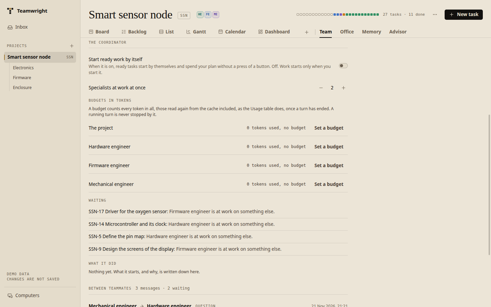

# The coordinator and budgets

This page explains how to let Teamwright start ready tasks by itself, and how
to put a limit on what the work spends.

Note: the coordinator is new in this version. It was tested at every layer
and seen working in a browser on the demo. It has never started a real
specialist and has never run in the installed program. Try it first on a small
project, and watch what it does.

## The coordinator

By default, work starts only when you press *Start work*. The coordinator
changes that for one project, and only when you switch it on. It spends your
Claude plan without a press of a button, which is why it is off at first.

1. Open the *Team* place and find *The coordinator* below the list of members.
2. Turn on *Start ready work by itself*.
3. Set *Specialists at work at once*, from 1 to 8. It starts at 2.

When it is on, the coordinator starts a task when all of this is true:

- The task is in a status that means not started or under way.
- It is given to an AI specialist of the team, never to a person, to you or to
  nobody.
- Nobody has worked on it before: there is no conversation about it anywhere.
- Every task it waits for, and every part of it, is in a status that means
  done. A status that means waiting to be checked is not done.
- Its specialist is free: it has no turn running on any computer and it does
  not wait for your answer to a question.

It never starts more specialists at once than the limit, and a specialist
works on one thing at a time. Tasks start in the order of their priority,
then of the board.

What it does not do:

- It never calls a task done. Finished work waits for you to accept it, and
  the coordinator says so ("SSN-3 is finished and waits for you to accept it"),
  with a press to accept.
- It never starts a task again. A task that was worked on and failed waits for
  you: read why, and go on with a reply. Nothing loops.
- It does not wait for sprints. Dependencies and owners decide.

The list *Waiting* says which tasks it is not starting, and why, for example
"Firmware engineer is at work on something else." The list *What it did* says
in a sentence what it started, and why, with the names true at the time.

**A teammate's question.** A free specialist with a waiting message of the kind
*question* gets a turn to answer it. This happens at most four times an hour in
a project. Past that, the question waits for the receiver's next turn.

**When Teamwright starts.** A coordinator that was on when the program closed
stays on and acts at start. Turns that were cut off by closing are failed and
not started again. If Claude Code is not installed or not signed in, the
coordinator switches itself off and says why.

**Several computers.** The coordinator acts on the one computer where you
switched it on. The others show where it runs, and switching it on there moves
it. Two computers could both start one task in the few seconds before the move
reaches the other.

## Budgets

A budget is a limit in tokens. You can set one for the whole project (the
Advisor included), for each member, and for each task.

1. In the *Team* place, under *Budgets in tokens*, press *Set a budget* in the
   row of *The project* or of a member. For a task, press *Set a budget* in its
   panel.
2. Type the number of tokens.

A budget counts every token in all, the ones read again from the cache
included, so that you compare one number with the number of the *Usage* table.
It counts once a turn has ended, so a running turn is never stopped. It may
go over by the size of that turn.

When a budget is used up:

- The coordinator stops starting work that counts against it.
- It asks you once in the inbox. You can raise the budget by half, raise it
  by all of it again, or leave the work stopped. It asks again only after you
  answered or changed the budget.
- Work that you start with *Start work* is warned about and not refused. A
  budget guards what runs without a press of a button, and your press is the
  decision.

Budgets count tokens, not money.
