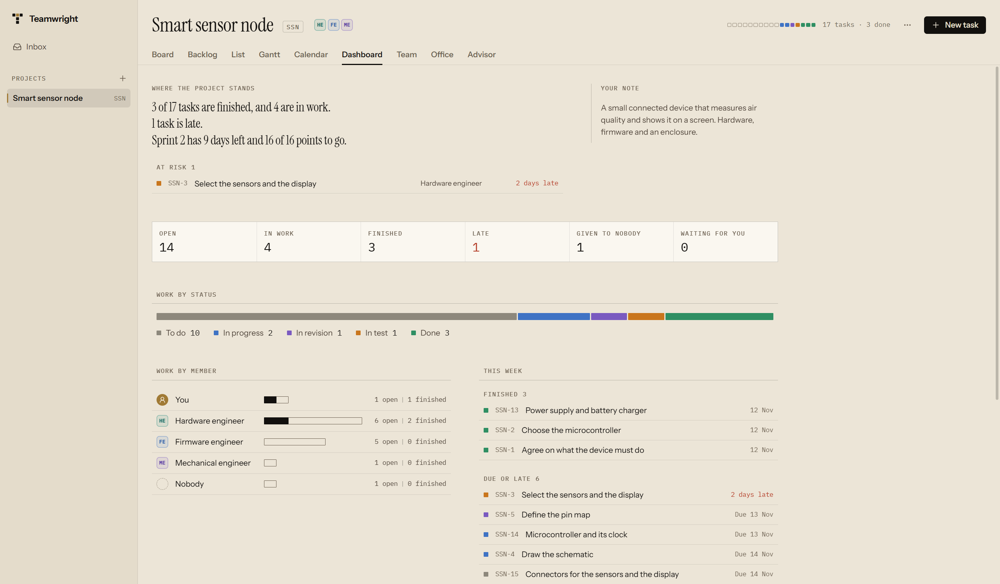
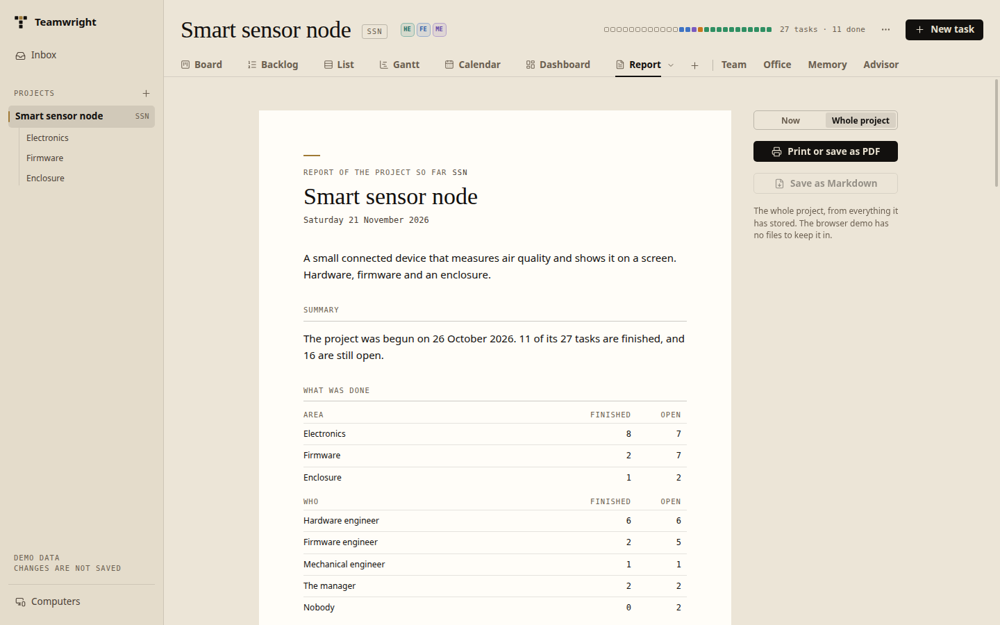

# The dashboard and the reports

This page explains how to see how a project is going on one page, how to
write it as an Excel workbook, and how to make the report of a whole project.

## The dashboard

The *Dashboard* view says how the project is going, on one page that reads
from top to bottom. There is nothing to set up.

<picture>
  <source media="(prefers-color-scheme: dark)" srcset="../screenshots/dashboard-dark.png">
  
</picture>

This picture was taken before the part *Latest activity* was added.

- **Where the project stands.** A few short sentences at the top, such as "5
  of 21 tasks are finished, and 4 are in work. 1 task is late. Sprint 2 has 9
  days left and 16 of 22 points to go. 1 thing waits for you." They are worked
  out from your tasks, sprints and conversations by fixed rules, so opening
  the page costs no tokens. A sentence with nothing to say is left out. A lane
  over its limit is said too. Under them, the tasks **at risk** are named:
  those that are not finished and are past their due date. Press one to open
  it.
- **Your note.** Beside the summary stands the description of the project,
  as the note you keep about it. Write in it where it is; it is saved when you
  leave the field.
- **The numbers.** Open, in work, finished, late, given to nobody, and waiting
  for you. *Finished* counts the tasks in a status that means done, whatever
  you called it. *Waiting for you* opens the inbox.
- **Work by status.** One bar with a part for every status, in the order of
  your workflow and in its colors.
- **Work by member.** For you, every member and the tasks given to nobody: a
  bar of what is given, filled in as far as it is finished.
- **This week.** What was finished since Monday, and what is due by Sunday or
  already late. Press a line to open its task.
- **Latest activity.** The newest entries of the log of the project, as the
  *Activity* view tells them, with a way to the Activity view, or to add it.
  Today this means changes to tasks. A specialist finishing a turn, or your
  answer to a question, is not in it. It was seen on demo data only.
- **The sprint.** For a project that uses sprints: the running sprint with its
  dates, its goal and its burndown, and the completed sprints with what each
  took on and what it finished. *Open the backlog* goes to the backlog.
- **Usage.** The tokens the Advisor and every AI specialist have used in this
  project, and the project as a whole. A person uses none and is not listed.
  A turn's tokens are counted when it ends.

A project without tasks, sprints or a team says what is missing in a sentence
and leaves those parts out. The dashboard does not show what Teamwright does
not know, such as how long anything will still take. It was seen in the
installed program on stored data with nobody at work.

When every task of a project is finished, the dashboard offers the report of
the whole project (see below).

## The Excel workbook

*Export to Excel…* in the menu of the project writes the project as a
workbook with four sheets: *Summary*, *Tasks*, *Sprints* and *Team*. The sheet
*Tasks* has a column for the tags of each task and, at its end, a column for
each custom field. A number is a number and a date is a date in the
spreadsheet. A dialog asks where to save the file.

A file written by the program's own code was opened in Excel, and the
installed program wrote one through its command. The dialog that asks where
to save was not tried. The browser demo cannot write files, and says so in the
menu.

## The Report view

The *Report* view is one page about the project, to print or save as PDF. Add
it with the **+** after the views.

At the right of the page:

- *Now* and *Whole project* choose the sheet.
- *Print or save as PDF* prints the page. Choose "Save as PDF" in the window
  of your system to keep it as a file.
- Under *Parts*, tick which parts of the *Now* sheet to include.

**The sheet *Now*** is the page as the project stands: where it stands,
progress, the sprint, what was finished this week, what is in work, what comes
next, what is late or waiting, the team and what the team used. Above it you
can write a few words for the reader.

**The sheet *Whole project*** is the report of a whole project. It is called
"Report of the project" when every task is finished and "Report of the
project so far" before. It has a summary, what was done by area and by member
and task by task, what was planned against what happened, the sprints, the
files the specialists changed, and the tasks still open. *Save as Markdown*
keeps it as a text file in the work folder of the project.

The report says only what the data can tell:

- Time is the time the specialists' turns ran. An estimate is the size of the
  work for a skilled person, and the report says so beside the comparison.
- The work of people is not timed. The report says so.
- Due dates are met or missed by the day of finishing.
- Nothing is written by a model, and nothing is guessed.

The whole-project report was seen in a browser on the demo, also for a
finished project. It has not been tried in the installed program, and the
layout for printing was not looked at.
