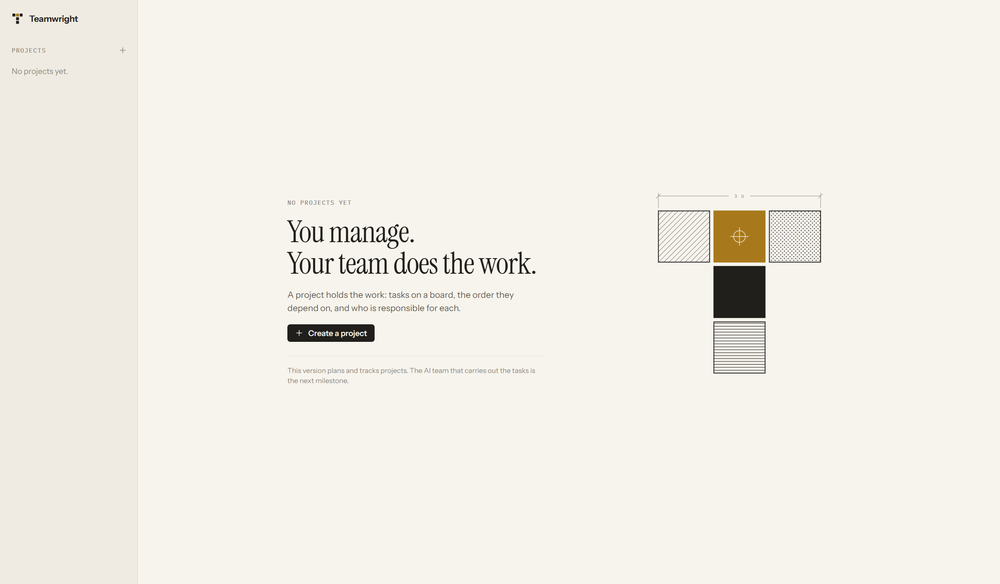
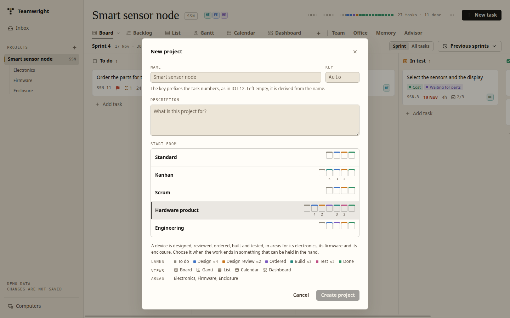
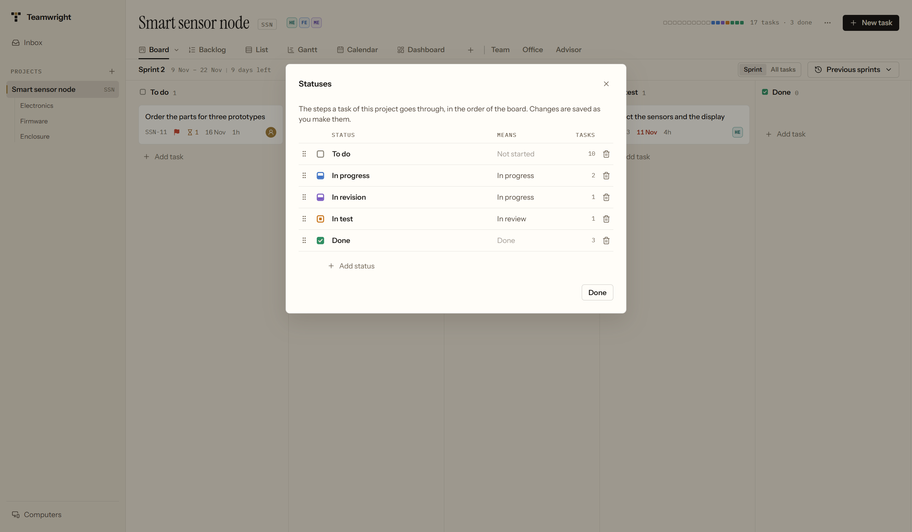
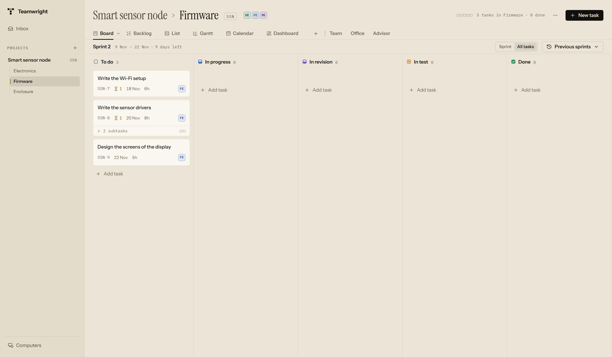

# Your first project

This page shows how to create a project, what the templates give you, and
how to change the statuses, areas and folders of a project.

A project holds one piece of work: its tasks, the statuses they move
through, and its team.

<picture>
  <source media="(prefers-color-scheme: dark)" srcset="../screenshots/first-run-dark.png">
  
</picture>

## Create a project

1. Press the plus sign next to *Projects* in the sidebar, or press *Create a
   project* on the first screen.
2. Fill in the form:
   - **Name.** What the project is called.
   - **Key.** A short code of two to six letters and digits that starts the
     number of every task, as in `IOT-12`. Leave it empty and Teamwright
     makes one from the name: "Smart sensor node" becomes `SSN`.
   - **Description.** What the project is for. The Advisor starts from it.
   - **Start from.** A template, described below.
3. Press *Create project*.

### The templates

Each choice shows a small picture of its lanes and says what it is for. A
template decides how the project starts: its statuses and their limits, its
views, its areas and, for Scrum, a first sprint. It never puts anybody on
the team. The Advisor proposes a team.

| Template | Statuses | Views | Also |
|---|---|---|---|
| *Standard* | To do, In progress, In review, Done | Board, Backlog, List, Gantt, Calendar, Dashboard | |
| *Kanban* | Backlog, Ready, In progress, Review, Done | Board, List, Calendar, Dashboard | [Limits](#limits) of 5 on Ready, 3 on In progress and 2 on Review. No backlog view and no sprints. |
| *Scrum* | To do, In progress, In review, Done | Backlog, Board, List, Dashboard | *Sprint 1*, planned and empty, ready to be filled |
| *Hardware product* | To do, Design, Design review, Ordered, Build, Test, Done | Board, Gantt, List, Calendar, Dashboard | Limits on Design (4), Design review (2), Build (3) and Test (2), and the areas Electronics, Firmware and Enclosure |
| *Engineering* | To do, In progress, In revision, In test, Done | Board, Backlog, List, Gantt, Calendar, Dashboard | |

A template is only a starting point. The project does not remember which
one it came from, and you can change or remove everything it made. The
templates were tested and seen in the demo. They have not been tried in the
installed program.

A new project is empty. It opens on the page of the
[Advisor](the-advisor.md), where it can be planned. The board is one press
away if you would rather add the tasks yourself.

## Switch, change, archive, delete

**Switch projects** by choosing one in the sidebar. A small brass line marks
the project that is open. Teamwright reopens the last project you worked in.

**Change a project** from the menu with the three dots in its header:

- *Name and description* opens a form for both. The key stays as it is,
  because it is part of the number of every task.
- *Statuses* opens the list of the [statuses](#statuses).
- *Areas* opens the list of the [areas](#areas).
- *Folders* says where the specialists work. See [folders](#folders).
- *Integrations…* connects the project to GitHub, Slack and web addresses.
  See [integrations](integrations.md).
- *Export to Excel…* writes the project as a workbook. See
  [the dashboard and the reports](dashboard-and-reports.md#the-excel-workbook).
- *Archive project* puts the project away. Nothing is lost: the sidebar then
  shows *Archived* under the list of projects, and from there a project is
  brought back, or deleted.
- *Delete project* removes the project for good, with its tasks and its
  team. Teamwright says what goes with it, and asks first.

## Statuses

The statuses are the steps a task goes through, and the lanes of the board.
Open *Statuses* in the menu of the project.

<picture>
  <source media="(prefers-color-scheme: dark)" srcset="../screenshots/statuses-dark.png">
  
</picture>

Every status has a name, a color and a meaning. The meaning is one of four,
and it is what Teamwright goes by, whatever you call the status:

| Meaning | What it says about a task |
|---|---|
| Not started | Work on the task has not started. |
| In progress | Work on the task is under way. |
| In review | The work waits to be checked. |
| Done | The task is finished. |

- **Rename** a status by typing over its name. Enter or leaving the field
  saves, Escape undoes.
- **Change the color** with the mark in front of the name, and **the
  meaning** with the word behind it. A status that becomes *Done* finishes
  the tasks in it, and one that stops being *Done* reopens them.
- **Move** a status by dragging the dots at the front of its row.
- **Add** a status with *Add status*. It appears with the other steps of the
  work, in front of the ones for review and done.
- **Remove** a status with the bin at the end of its row. If tasks are in
  it, Teamwright asks which status they should go to.

A project always keeps one status in which work has not started and one in
which it is done. Changes are saved as you make them.

### Limits

A status can have a limit: the most tasks that should stand in it at once.
Type it in the column *Limit*, or empty the field to have none. A status in
which tasks are done has no limit, because finished work only piles up
there.

On the board, the head of a lane with a limit shows its tasks against the
limit, as in `2/3`, with a small gauge. A lane over its limit shows its
figure and gauge in red, with the word *over*. The dashboard says which
lanes are over.

A limit never stops anything. You can still move a task into a full lane,
and a specialist can always hand its finished work on. The limit only shows
that too much is under way. It counts every task of the project in the
status, in every area and sprint, whatever the view shows. A task with
subtasks counts once.

Limits were tested and seen in the demo. They have not been tried in the
installed program.

## Areas

A project can be cut into areas, one for each job inside it: the
electronics, the firmware and the enclosure of a device. Every task is in
one area. A new project has one, called *General*, and as long as it has
only one you see nothing of areas at all.

<picture>
  <source media="(prefers-color-scheme: dark)" srcset="../screenshots/area-dark.png">
  
</picture>

*Areas* in the menu of the project opens the list. It works like the list of
statuses:

- **Add** an area with *Add area*.
- **Rename** it by typing over its name. Two areas cannot have the same name.
- **Move** it by dragging the dots at the front of its row.
- **Remove** it with the bin. If tasks are in it, Teamwright asks which area
  they should go to. The last area cannot be removed.

Once a project has two areas, they appear at the side under the name of the
project. Press an area to see only its tasks in every view. The header names
it, as in *Smart sensor node › Firmware*. A filter of a view still applies
on top. Press the name of the project to see every area again. Team,
Office, Memory and Advisor always show the whole project.

A task you make while an area is open goes into that area. In the panel of a
task, *Area* says where it is; choose another area there to move the task
with its subtasks. Sprints belong to the whole project: in an area, a sprint
shows the tasks of that area, and its burndown still counts all of them.

## Folders

*Folders* in the menu of a project says where its specialists work on this
computer, and what else they may read or change. Each folder is listed with
its kind at the end of its line: *work*, *written* or *read only*.

- **Work folder.** Here the specialists read, create and change files.
  Teamwright makes a folder for every project. *Choose another folder* lets
  them work somewhere else, for example in a folder that already holds the
  project. What they change there is changed for real. *Use the folder of
  Teamwright* goes back. The work folder cannot change while a specialist
  works in the project.
- **Folders to write in.** Further folders the specialists may read and
  change as they do the work folder, for example the repository of the
  firmware next to the one of the board. *Add a folder to write in* asks
  for the folder; the bin at the end of its line takes it away again, and
  leaves the folder itself where it is. The specialists are told which
  folders these are. A folder to write in cannot be the work folder, a
  reference folder or another folder to write in, nor lie inside or around
  one of them: a folder has one kind. It can never be, lie inside or hold
  Teamwright's own data, the sync folder, the settings of Claude Code
  (`.claude` in your home folder) or the folders of your SSH and GnuPG
  keys. So your whole home folder cannot be one; *full access*, below, is
  the switch for that.
- **Reference folders.** Folders with material the specialists should know:
  data sheets, an earlier design, a standard. They can read everything in
  these folders, PDF files included, and cannot change anything in them. A
  reference folder cannot be the work folder, lie inside it or contain it.
- **Reference files.** *Add files* copies single files into the folder
  `references` inside the work folder. The specialists see the copies, and
  nothing else of the folder a file came from.
- **Full access.** A switch, off until you switch it on. When it is on, the
  specialists of this project may read and change files anywhere your
  account can, not only in the folders above: a specialist can then change
  or delete any of your files. Switching it on asks you once to confirm.
  Even then, Teamwright's own data, the sync folder, the settings of Claude
  Code and your SSH and GnuPG keys stay closed, for reading too, reference
  folders stay read only, and no command can be allowed in the project. The
  choice is kept for this computer only; your other computers keep their
  own. While it is on, *Full access* stands quietly above the team and at
  the head of a specialist's conversation. See
  [what a specialist may do](safety-and-trust.md#full-access).

Folders to write in, like the other folders, are facts of this computer:
they are not synced, and another computer of yours has its own.

Teamwright never deletes a folder or a file of yours, also not when you
delete the project. What a specialist reads is sent to Anthropic under your
account, like everything Claude Code reads.
