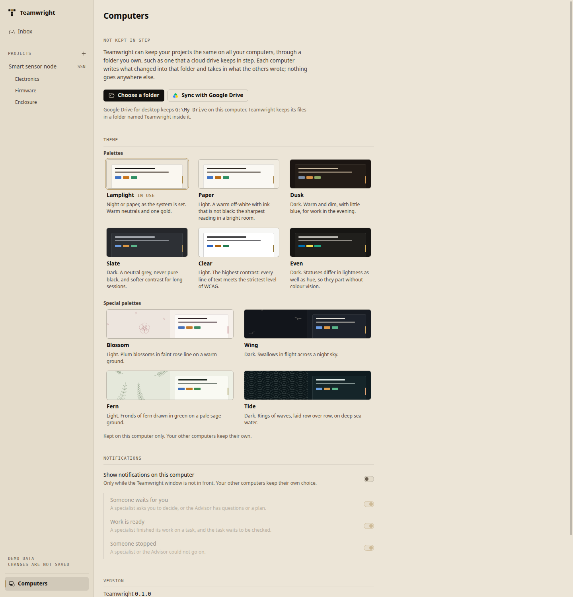

# Settings of this computer

This page explains the settings on the page *Computers*: the theme, the
notifications, the switch of command permissions and the notice of a newer
version. They are kept on this computer only. Your other computers keep
their own.

Open *Computers* at the foot of the sidebar.

## Themes

*Theme* offers thirteen palettes. Press one to use it. The window changes to it in
a moment.

- **Lamplight** is the look the program had, and the default. It follows the
  light or dark setting of your system: "Night or paper, as the system is set."
- **Paper** (light), **Dusk** (dark), **Slate** (dark), **Clear** (light, the
  highest contrast) and **Even** (dark, with statuses that differ in
  lightness as well as hue, so they part without color vision) are made for
  the eyes and for long work.
- **Rose** (pink), **Delft** (blue) and **Poppy** (red) are light, each a
  white ground with one color. The color marks what is chosen, what has the
  focus and the head of the window. In Poppy, trouble (a late date, a limit
  that is passed, a refusal) is a darker, cooler red than the color of the
  theme, so the two are not taken for each other.
- **Blossom**, **Wing**, **Fern** and **Tide** are special palettes that carry
  a pattern.

Themes were seen in a browser on the demo. The change of theme in the
installed program, and the script that sets it before the first paint, were
never tried.

## Notifications

Notifications come from your operating system. They are off until you allow
them. The program asks once, in the inbox.

*Show notifications on this computer* is the main switch. They show only while
the Teamwright window is not in front. Three switches say which events tell
you:

- *Someone waits for you*: a specialist asks you to decide or asks for a
  permission, or the Advisor has questions or a plan.
- *Work is ready*: a specialist finished its work on a task, and the task
  waits to be checked.
- *Someone stopped*: a specialist or the Advisor could not go on, or the limit
  of your Claude plan was reached (once, however many specialists it stopped).

Once the main switch is on there is a way to send a test notification. In the
installed program the choice was made and kept and the test notification was
sent without a refusal. Nobody has yet seen a notification on the screen, and
none was pressed.

## Commands

Under *Commands* is the switch *Let specialists ask to run commands on this
computer*. It is off until you switch it on, on each computer.

- Off, a specialist can ask you only to fetch pages from a web domain. A
  request for a command is refused before it reaches you, and no command
  runs, whatever you allowed before.
- On, a specialist can ask you to run one exact command, such as
  `npm test`, and you can allow it once or for a task (see
  [when a specialist asks for a permission](work.md#when-a-specialist-asks-for-a-permission)).

The words beside the switch say what it means. A specialist can change the
files a command runs (scripts, build files, tests), so allowing a command
lets it run any program as you. Commands are meant to run in a sandbox that
keeps them inside the folders of the project, and that sandbox has not been
proven in this version of Teamwright. Keep it off unless you trust the files
of your projects. If this computer can run no command even when it is on
(Windows, a Linux without `bubblewrap` and `socat`, a Linux that does not
allow the sandbox to start a protected space inside another one, or Claude
Code signed in with an environment variable), the part says why.

On Ubuntu 24.04 as it is installed the part says *Even switched on, no
command can run on this computer*, and that the system does not allow one
protected space inside another. That is a setting of the system, and only an
administrator of the computer can change it; Teamwright never changes it, and
you should not weaken it only for Teamwright. Everything else works: the
specialists read and write files in their folders and reach the web domains
you allow. Only commands are missing.

Web domains do not depend on this switch. The switch was tested and seen in
the demo, in a dark and a light theme; no command has run with it in the
installed program.

## A newer version

Under *Version* the page shows the version of this program, for example
"Teamwright 0.1.0".

- *Look for a newer version once a day* is off until you switch it on. Then
  Teamwright asks GitHub for the list of its releases, at most once a day. The
  request says only the address of the list and the version of this program.
- *Look now* looks at once, whether or not the switch is on, and says when it
  last looked. It does not turn the switch on.
- When a newer version is known, a card names it, says where it comes from,
  and offers *Install 0.3.0* (with the number of the new version) and *Open the
  release page*. A small line "0.3.0 is out" also shows at the foot of the
  sidebar. Nothing waits for you, so it is quiet.
- A network that is down is not an error. The page only says that it could
  not look.

A pre-release is offered only while you run a pre-release yourself, or while no
full release exists.

### Installing a newer version

Teamwright installs a newer version only when you press *Install*, and
restarts only when you say so.

1. Press *Install 0.3.0*. Teamwright asks for the update, downloads it and
   shows how much has arrived.
2. It checks that the download is signed with the key built into Teamwright.
   A download that is not is thrown away, and the card says so: "The download
   was refused". Nothing is installed then, and the version you have still
   runs.
3. When the new version is ready the card says so and offers *Restart now* and
   *Later*. *Later* is fine: the new version starts the next time you open
   Teamwright. On Windows the new version is installed when you choose
   *Restart now*.
4. If specialists are at work, the card says how many. A restart stops them,
   as closing Teamwright does, so the button then reads *Stop them and
   restart*. You can continue their conversations afterwards.

If the card says there is nothing newer for this computer yet, the release
may still be on its way; try again later, or use the release page.

**Version 0.2.0 cannot do this.** It was published before Teamwright could
install its own updates. Install the next version by hand once, from the
release page (see [installing](what-teamwright-is.md#installing)); from then
on it updates itself.

**Copies that update by hand.** On Linux, a copy installed from the `.deb` or
the `.rpm` belongs to the package manager of the system, so Teamwright does not
replace it: install the new package the same way. The AppImage updates itself.
A copy built from the source has nothing to replace either. In both cases the
card keeps the release page and says why.

**On a Mac.** Move Teamwright to Applications before you first open it. A
program opened from the Downloads folder or the disk image may run from a
hidden copy that cannot be replaced. Only the first install shows the warning
about an unidentified developer; an update installed by Teamwright itself is
expected not to show it again. That was never tried on a Mac: tell the project
what you see.

What was tried: on Linux, an older AppImage built for the test found a newer
one on a server on the same computer, refused a copy signed with another key,
downloaded the right one with its progress, installed it and restarted as the
new version. Updating through GitHub, on Windows and on a Mac has not been
tried yet; the first real release will be the first.
