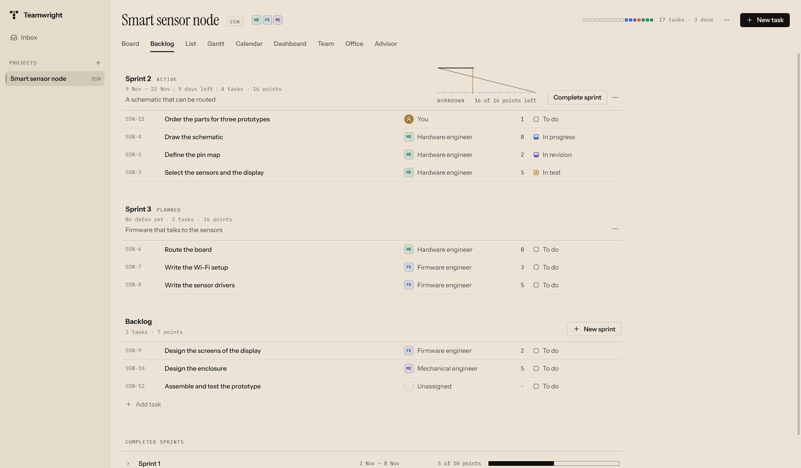

# Sprints and the backlog

This page explains how to plan work in sprints, follow a sprint with its
burndown chart, and read the pace of your team.

You can plan the work in sprints, as Scrum does: a sprint is a stretch of one
to four weeks in which the team works on a chosen part of the backlog. You do
not have to. Without sprints every task is in the backlog and the board shows
all tasks. The Scrum template starts with the Backlog view in front.

## The Backlog view

It reads from top to bottom: the sprint that runs, the sprints planned to
come, the backlog of everything that is not planned yet, and at the foot the
sprints that are over. Each sprint shows its name, its dates, its goal, how
many tasks and points it holds and, while it runs, how many days are left.
Under it are its tasks: the reference, the title, who it is given to, its
points and its status. Subtasks are not listed: they go where their task goes.

<picture>
  <source media="(prefers-color-scheme: dark)" srcset="../screenshots/backlog-dark.png">
  
</picture>

## Working with sprints

- **New sprint**, at the backlog, plans a sprint. Its name may be left empty:
  it is then called *Sprint 4*, after the number of sprints the project has
  had. The goal and the dates can wait until it starts.
- **Plan a task** by dragging its row into a sprint, or back into the
  backlog. Or open the menu at the end of the row (it appears when you point
  at the row or reach it with Tab) and choose *Move to*. A completed sprint
  takes no more tasks.
- **Story points** say how big a task is compared with other work: a whole
  number from 0 to 999. Click the points in a row to change them, or change
  them in the panel of the task. They stand next to the estimate in hours,
  which stays what it is.
- **Start sprint** asks for the name, the goal and the dates. It offers today
  and two weeks later; the keys *1 week*, *2 weeks* and *4 weeks* set the end
  in one step. A sprint needs at least one task to start, and only one sprint
  runs at a time.
- **Complete sprint** says how many of its tasks are finished, and asks where
  the unfinished ones go: to the backlog or to a planned sprint. Their
  subtasks go with them. The finished tasks stay in the sprint as its record.
- The menu of a sprint changes its name, goal and dates, and deletes a sprint
  that has not started; its tasks go back to the backlog. A sprint that runs
  cannot be deleted, and a completed one cannot be changed.

## The burndown chart

The chart stands next to the sprint that runs.

- The thin line falls from the work the sprint was started with on its first
  day to none on its last: the pace its dates ask for.
- The ink line is what really remained at the end of each day, in points if
  any of its tasks has points and in tasks otherwise.
- The brass line is today.
- The chart follows tasks that join or leave the sprint while it runs. On the
  day a task is planned in, the ink line steps up, and on the day one is taken
  out or deleted, it steps down. Such a day gets a small triangle, a dotted
  line shows all the work the sprint held, and under the chart the day is said
  in words, such as "19 Nov 1 task joined, 3 points; 1 task left, 2 points".
  New points on a task already in the sprint are said too ("re-estimated, +3
  points"). Rest the pointer on a line to see which tasks they were.

The chart is worked out from the record of changes Teamwright keeps. It was
tested on the real database and seen in a browser on the demo. It has not been
run in the installed program.

## The pace of the team

Once three sprints are completed, the backlog says how many points the team
finished in a sprint, as a range from the least to the most over its last
sprints (up to six): "The team finished 5–11 points a sprint over its last 3
sprints." It then says how many sprints the work not yet finished would take at
that pace, and names the tasks without points, which it cannot count. A
planned sprint says how what you put into it compares with the pace. With
fewer than three completed sprints it says that it is too early to tell.

The pace is worked out from the completed sprints by fixed rules, not guessed.
It is a range, never one number, because sprints differ.

## Completed sprints

Completed sprints keep what they took on and what they finished: "13 of 15
points". The bar beside it shows the same on one scale for all of them.

Press the line of a completed sprint to open it where it stands, and press it
again to fold it. Opened, it shows its goal, its dates, what it took on and
what it finished, its burndown as it ended, and its tasks. *Moved on when it
was completed* lists the unfinished ones, each with its points and where it
went. The sprint is over, so its rows cannot be dragged and their points
cannot be changed.

## The board and sprints

The board shows the tasks of the sprint that runs. The switch at the top
right, *Sprint* and *All tasks*, shows every task again. A task you add on the
board of the sprint goes into the sprint.

*Previous sprints*, next to the switch, lists the sprints that are over.
Choose one and the board shows the tasks it finished. The header names the
sprint, says that it is completed and gives its dates and its result. The key
at its right, *Back to* the sprint that runs or *Back to all tasks*, leads
back. Without a running sprint the board shows all tasks.

A sprint was planned, filled, started and completed in the installed program
and was there after a restart. The tasks that moved on when a sprint was
completed, and the pace of the team, were seen in the demo only.
