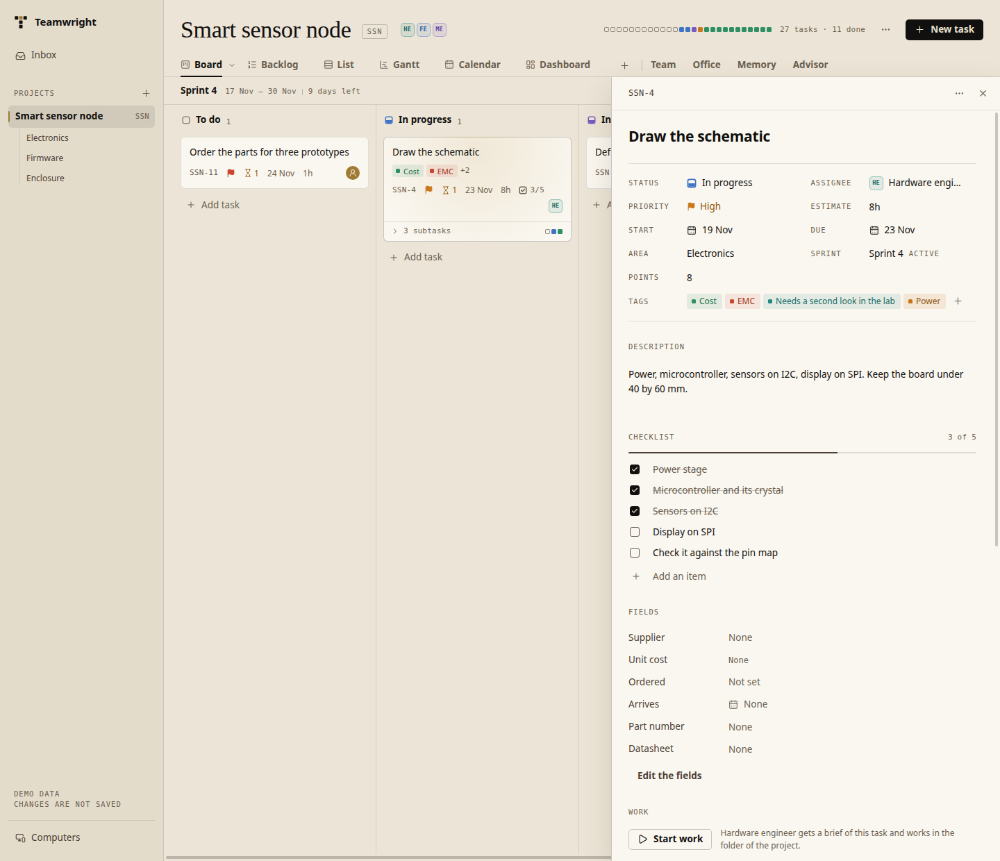
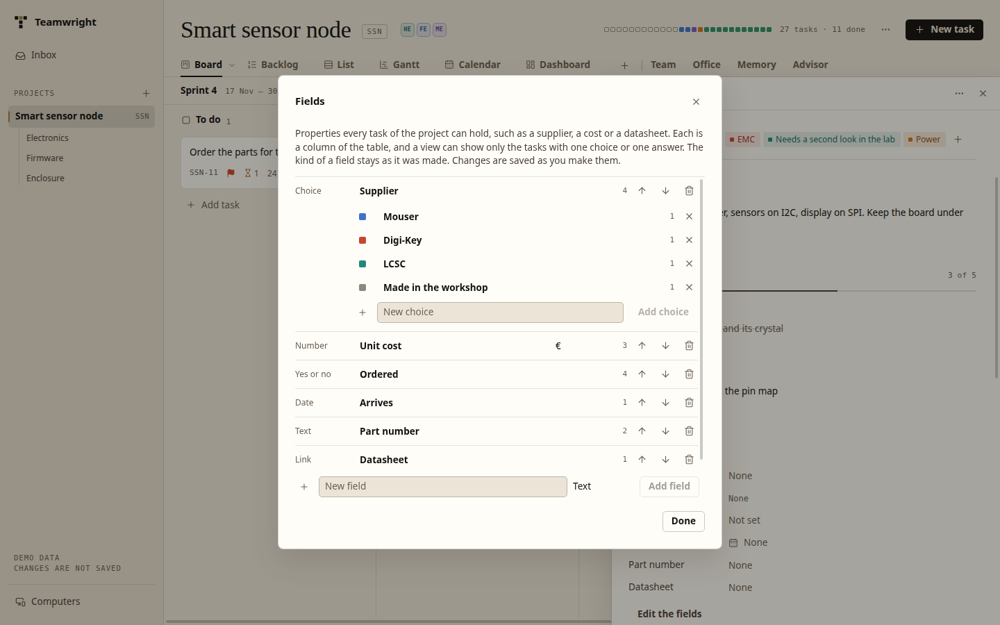

# Tasks

This page explains how to create a task, what its panel holds, and how to
divide, mark, check and describe a task.

## Create a task

- *New task* in the header opens a task by its title and shows it at once,
  so you can assign it and fill in the rest.
- *Add task* at the bottom of a status on the board adds a task to that
  status. The line stays open, so you can type one task after another.
  Escape closes it.
- *Add task* under *Subtasks* in a task adds a part of that task.

A task you make while an area is open goes into that area. A task you make
on the board of a running sprint goes into the sprint.

## The panel of a task

Click a task on the board or in the list to open its panel.

The panel shows these parts, from the top:

| Part | What it is |
|---|---|
| Status | Where the task stands. Choosing another status moves the task. |
| Assignee | Who is responsible: you, a member of [the team](the-team.md), or nobody. |
| Priority | Urgent, high, normal or low. Urgent and high show a colored flag. |
| Estimate | The expected working time. Type it as `90m`, `2h` or `1h 30m`. |
| Start, Due | The planned dates. A task cannot start after it is due. |
| Part of | The task this one is a part of, or "A task of its own". See [subtasks](#subtasks). |
| Area | Where the task is. Choose another area to move it with its subtasks. |
| Sprint | The sprint of the task. Move it to another sprint or to the backlog here. |
| Points | The story points. See [sprints and the backlog](sprints-and-backlog.md). |
| Tags | See [tags](#tags). |
| Description | Details, acceptance criteria, links. |
| Checklist | See [checklists](#checklists). |
| Fields | See [custom fields](#custom-fields). |
| Work | What the AI specialist the task is given to does with it. See [work](work.md). |
| Budget | The tokens used on the task, and a limit if you set one. See [the coordinator and budgets](coordinator-and-budgets.md). |
| Waits for | The tasks that must be finished before this one can start. |
| Subtasks | The parts of this task. |
| GitHub | Pull requests and issues that name the task. See [integrations](integrations.md). |
| History | What has happened to the task. See [the history](#the-history). |

Changes are saved as you make them. The title, the description and the
estimate are saved when you leave the field or press Enter. Escape undoes an
edit that is not saved yet.

**Delete a task** from the menu with the three dots in the panel (*Delete
task*). Its subtasks are deleted with it, and tasks that waited for it stop
waiting.

## Subtasks

A task can be divided into subtasks, and a subtask can have subtasks of its
own. Add one with *Add task* under *Subtasks* in the panel.

On the board and in the list a subtask is shown under its task. A task with
subtasks has a small row that says how many there are, with one block for
each in the color of its status. Press it to unfold the subtasks, and again
to fold them away. Teamwright remembers which tasks you unfolded.

A subtask has a status of its own. It stays under its task whatever that
status is. To change it, open the subtask. A subtask is always in the area
and the sprint of its task.

**Move a task under another task**, or out from under one, with *Part of*
in its panel. Press the value to pick the task it is to be a part of; type
to narrow the list. Its own subtasks go with it. The cross makes it a task
of its own again. A task that moves under another goes into the area and
the sprint of its new task, with its subtasks; a task made one of its own
keeps the area and the sprint it has. The history of the task says where
it moved.

Teamwright refuses a move that would leave tasks that can never start, and
says why: a task cannot be a part of itself or of one of its own
subtasks, and it cannot go under a task it waits for, directly or through
other tasks, because a task with subtasks starts only once they are
finished. For the same reason a subtask cannot wait for its own task. To
regroup many tasks at once, ask [the Advisor](the-advisor.md#regroup-tasks-that-exist).

This was tested at every layer, seen in the demo, and done in the built
program on Linux, where a move survived a restart. It was not tried on a
Mac.

## Tasks that wait for other tasks

A task can wait for any number of other tasks of the same project. Add one
with the plus under *Waits for*. On the board, an hourglass with a number
shows how many of the tasks a task waits for are not finished.

Teamwright refuses a dependency that would make tasks wait for each other in
a circle, and says which tasks are involved: "SSN-1 cannot wait for SSN-3,
because SSN-3 already waits for SSN-1."

## Tags

Tags mark work across statuses and areas, such as *Cost*, *EMC* or *Waiting
for parts*. A tag belongs to one project. It has a name of up to 30
characters, and a color.

1. In the panel of a task, press the plus after *Tags*.
2. Type in the field *Find or make a tag…*. Choose a tag from the list, or
   type a new name to make a tag.
3. To take a tag off a task, use the small button on the tag (its name for
   a screen reader is "Take Cost off", for a tag called *Cost*).

A task can have any number of tags. Cards on the board show them, and so do
the list, the table and the Excel workbook. A view can be filtered by one
tag, or grouped by tags (see [views](views.md)).

Tags are saved and synced one by one: if you add one tag on one computer and
another on a second computer, both stay. Tags were tested and seen in the
demo. They have not been run in the installed program.

A task you make in a view that is filtered by a tag does not get that tag
yet, so it may leave the view at once.

## Checklists

A task has one checklist: a list of small steps that are done or not done.
It is lighter than subtasks. A step has no owner, no status and no dates.
If a step needs one of those, make it a subtask instead.

- Press *Add an item* and type the step.
- Tick a step when it is done. The line above the list says how many are
  done ("3 of 5"), and the card on the board shows the same as `3/5`.
- Each step has a menu (*Item actions*).

A checklist has at most 100 steps, each of at most 200 characters.

## Custom fields

Custom fields are properties of your own that every task of a project can
hold, such as a supplier, a unit cost or a datasheet.

1. In the panel of a task, press *Edit the fields*. The dialog *Fields*
   opens.
2. Type a name in *New field*, choose the kind, and press *Add field*.
3. Fill in the value of the field in the panel of each task, under *Fields*.

The kinds are:

- **Text:** one line of up to 200 characters.
- **Number:** an ordinary number, with a unit if you give one, such as `€`
  or `mm`.
- **Date.**
- **Yes or no.**
- **Choice:** one of a list. Add the choices under the field with *Add
  choice*. Each choice has a name and a color.
- **Link:** a web address that starts with `https://`.

The kind of a field never changes after it is made. If you chose wrongly,
make a new field and remove the old one. The arrows in a row move the field,
and the bin removes it. Removing a field clears its values from every task.
A project can have up to 30 fields. A field's name is at most 40
characters.

Where fields show up:

- In the panel of every task, under *Fields*.
- As a column of the *Table* view (see [views](views.md#the-table)).
- As a filter of a view: one choice of a choice field, or yes, or no, of a
  yes-or-no field.
- As a column at the end of the *Tasks* sheet of the Excel workbook.

Cards of the board and rows of the list do not show fields.

Custom fields were tested at every layer and seen in the demo. They have not
been run in the installed program.

## The history

*History* at the foot of the panel lists what has happened to the task, the
latest change first: when it was opened, who it was given to, where it
moved, which dates it got, which sprint it was planned into, how many points
it was given, when a tag was put on or taken off, when a checklist step was
ticked, and when a field value was set, changed or cleared. If another
computer made a change, the history names that computer.

The history is read from the record of changes that Teamwright keeps. It
begins when the task was opened.
