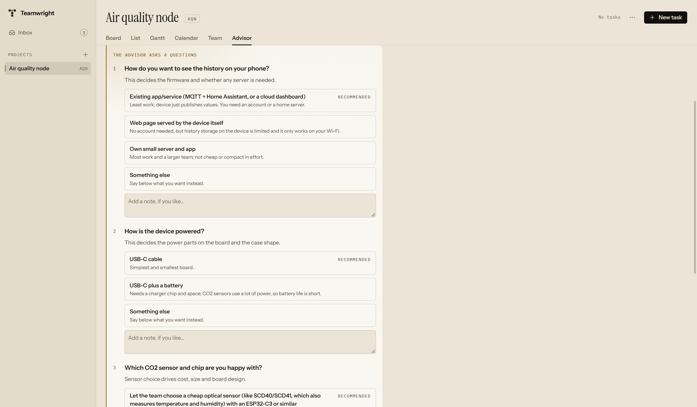
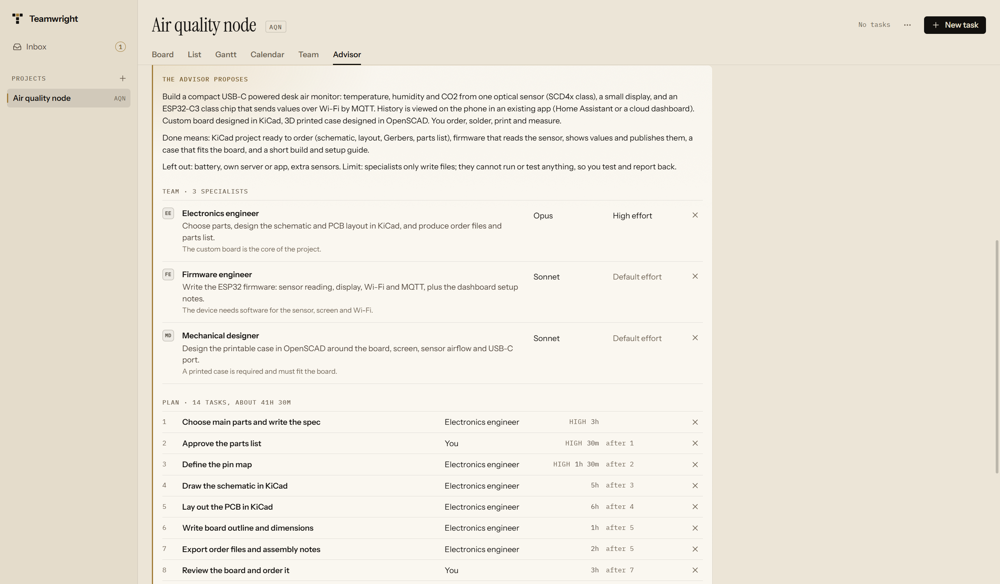
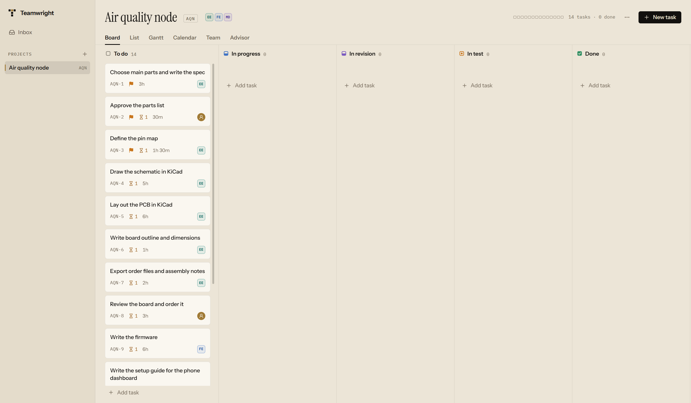

# The Advisor

This page explains how the Advisor turns what you want into a team and a
plan, and how you change, approve and extend what it proposes.

The *Advisor* is under the tab *Advisor* of every project. It is a session of
your own Claude Code, like a specialist. Planning takes two or three turns,
and they count against your plan. A lighter model makes a plan too; it will be
a plainer one.

The Advisor can read the [folders](first-project.md#folders) of the project
and cannot change anything in them. Put what it should know there before you
start.

## Say what you want

1. Open the tab *Advisor*. It says "Plan this project with the Advisor".
2. In *What you want*, write in your own words what is to be built, what you
   have already, and what matters most. The description of the project is
   there to start from.
3. Choose the *Model* and the *Effort* the Advisor runs on, or leave both to
   Claude Code.
4. Press *Start planning*.

## Answer its questions

If the Advisor needs to know something before it can plan, it asks: up to
five questions at once, each with the reason it asks. Where it offers
options, pick one. The one it recommends is marked *Recommended*. Or pick
*Something else* and say what you want. A question without options is
answered in words. You can add a note to an answer. Press *Send answers* when
every question has an answer. The Advisor may ask a second time.

<picture>
  <source media="(prefers-color-scheme: dark)" srcset="../screenshots/advisor-interview-dark.png">
  
</picture>

## Read the proposal

The Advisor proposes three things:

- **The project in its words**, for you to check: what is built, what "done"
  means, what is left out, and what is yours because a specialist cannot do
  work that needs hands, money or an account.
- **The specialists to add to the team.** Each has what it is responsible for,
  why the project needs it, and the model and the effort it runs on. If the
  team already covers the work, it says "Team: nobody new".
- **The tasks.** Each has who does it, its size, and the tasks it waits for.
  Press the title of a task to read what the Advisor wrote about it.

The size of a task is the Advisor's estimate of the hours a skilled person
would need. It says how large the task is. It does not say how long a
specialist takes.

<picture>
  <source media="(prefers-color-scheme: dark)" srcset="../screenshots/advisor-proposal-dark.png">
  
</picture>

## Change it

Nothing is added to the project before you press *Approve*, so change what
does not fit first.

- The cross at the end of a row takes a specialist or a task out. The tasks
  of a specialist you take out stay in the plan and are given to nobody.
- Press the owner of a task to give it to somebody else. Press the model or
  the effort of a specialist to choose another.
- Open the details of a task to change its title, size, description,
  priority and what it waits for.
- *Add task* adds a task of your own.
- For anything larger, write to the Advisor under the proposal what to
  change, and press *Send*. It proposes again.

Each change is stored, and reaches your other computers. There is no way to
go back to the Advisor's first version after you changed it: it is not kept.
This was tested at every layer and seen in the demo with its pretended
Advisor. It was not tried in the installed program or with a real Advisor.

## Approve it

Press *Approve*. The specialists join the team, and the tasks appear in the
first status of the board, each given to its owner. No work starts by
itself: you start a task when you want it started. A specialist the team
already has is not added a second time. The Advisor is told that you approved
the plan, as you approved it.

<picture>
  <source media="(prefers-color-scheme: dark)" srcset="../screenshots/advisor-board-dark.png">
  
</picture>

## Later

Write to the Advisor again when the project needs more. It knows who is on
the team and which tasks exist, and proposes what is to be added. It is told
not to repeat a task, but Teamwright cannot tell a task that says the same
thing in other words, so read what it adds. *Plan something new* starts a new
conversation. What the Advisor waits for, answers to its questions or a word
about its proposal, is also counted in [the inbox](work.md#the-inbox).

## Importing earlier conversations

If you talked about the project with Claude Code before, the Advisor can
start from a short account of each conversation instead of asking again.

1. In the tab *Advisor*, press *Import earlier conversations*.
2. Teamwright lists the conversations it finds on this computer, by folder.
   The folders of this project come first and are marked "Folder of this
   project". Choose one.
3. Read what would be kept: a title and the text "What the Advisor will
   read". You may cut or correct both. It holds the first request, the later
   requests, the names of the files that were changed, and the last answer,
   at most 8,000 characters.
4. Press *Keep this digest*. *All conversations* goes back to the list.

What is kept, and what is not:

- Only what you typed, the names of changed files and the last answer are
  kept. What a tool answered, and what a file contains, never is.
- What looks like a secret, such as a token or a password, is replaced by
  `[hidden]`. Teamwright guesses, and hides too much rather than too little,
  but it cannot promise to find everything. Read the digest before you keep
  it. It goes with the project to your other computers.
- The conversation itself is never copied. It stays where it is.
- The Advisor gets the kept digests with its first turn, newest first. A
  digest kept later reaches the next conversation. Specialists do not see
  digests. What every specialist must know belongs in the
  [memory of the project](work.md#the-memory-of-a-project).

This was tested, and seen in the demo with made-up conversations. A test
read the real conversations of the development computer. It rests on the file
format of Claude Code, which Anthropic does not publish, so a new version of
Claude Code may find less. It has not been tried in the installed program, and
no real Advisor has read a digest.
