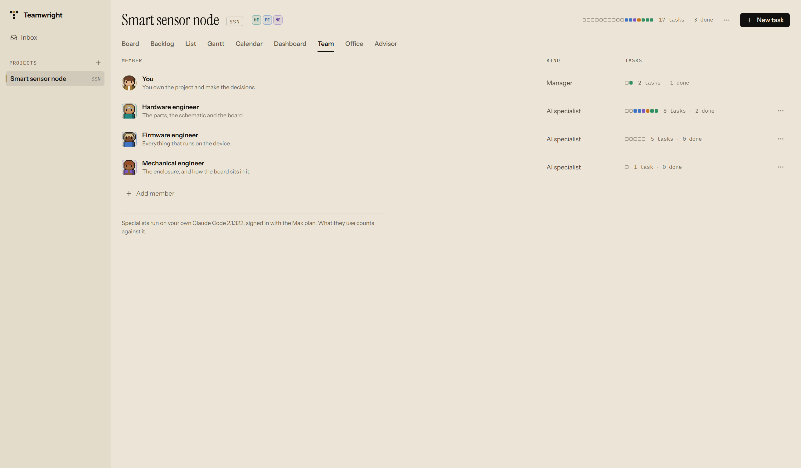
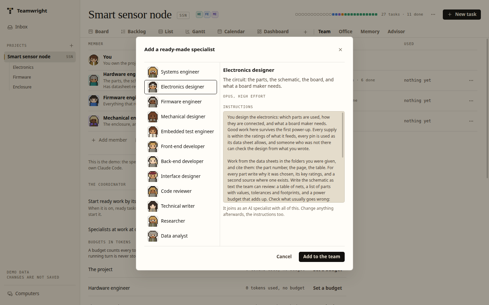
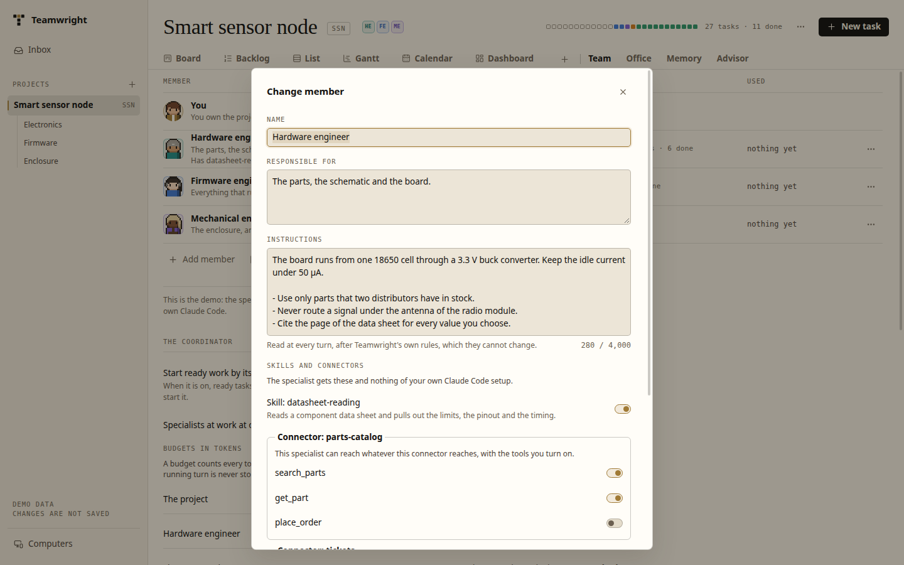
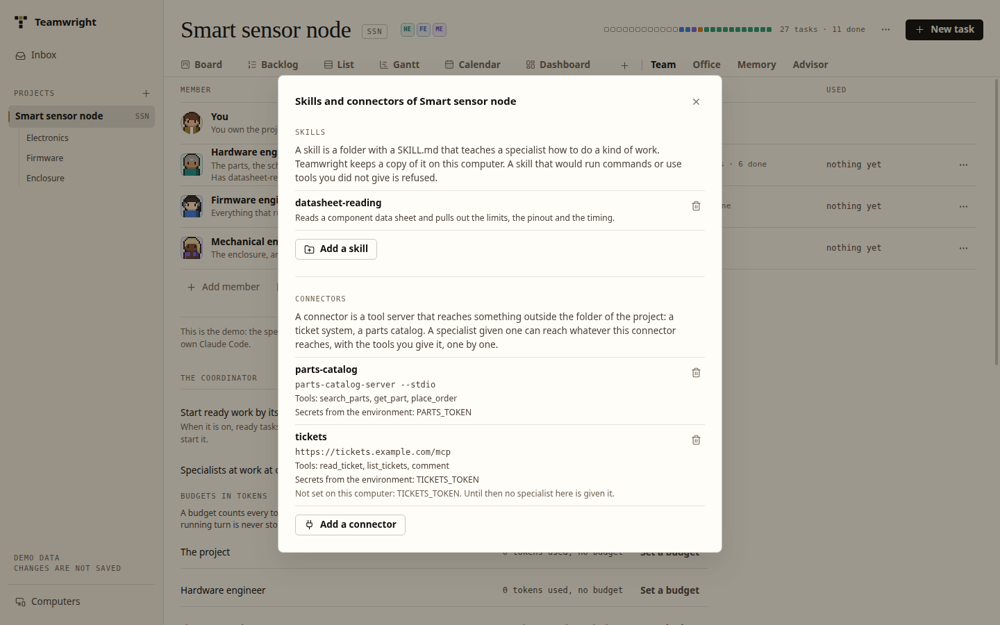

# The team

This page explains how to put together the team of a project: who can be on
it, how to add ready-made specialists, how to tell a specialist how to work,
and how to give it skills and connectors.

A project has a team: the help you bring in. A member is an AI specialist or
a person, and a task can be given to either. Open the *Team* place.

<picture>
  <source media="(prefers-color-scheme: dark)" srcset="../screenshots/team-dark.png">
  
</picture>

This picture was taken before the coordinator, the budgets and the messages
were added below the list of members.

An **AI specialist** carries out the tasks you give it and answers your
questions (see [work](work.md)). A **person** is a name that tasks can be
given to. Teamwright does not notify a person, and a person does not use
Teamwright themselves yet.

Teamwright gives every member a color. Where there is no room for a name, a
member is shown by its initials in its color:

| Shape | Who |
|---|---|
| A brass circle | You, the manager |
| A block with initials | An AI specialist |
| A circle with initials | A person |
| A dashed circle | Nobody |

## Add a member

Press *Add member* at the bottom of the list.

- **Kind.** *AI specialist* or *Person*. It cannot be changed afterwards.
- **Name.** What the member is called on the team. For a specialist this is
  usually its discipline, as in "Hardware engineer". No two members of a
  team can have the same name.
- **Responsible for.** A sentence about what the member is on the team for.
- **Model** and **Effort**, for an AI specialist. See
  [model and effort](#model-and-effort).

## Add a ready-made specialist

*Add a ready-made specialist* opens a chooser with twelve roles. Press a role
to read what it is for and its instructions, then press *Add to the team*.

| Role | What it is for |
|---|---|
| Systems engineer | Requirements, the budgets of power, size and cost, and the interfaces between the parts |
| Electronics designer | The circuit: the parts, the schematic, the board, and what a board maker needs |
| Firmware engineer | The firmware of the device: drivers, the main loop or tasks, and how the device talks to the world |
| Mechanical designer | The enclosure and the mechanical parts: dimensions, materials, how they are made and put together |
| Embedded test engineer | How the device is proven to work: the test plan, the test cases and the checks on the bench |
| Front-end developer | The interface people use: screens, interaction and how it looks |
| Back-end developer | The server side: the data, the rules behind it, and the interfaces other programs call |
| Interface designer | How the product is used and how it looks: the flows, the layouts and the words on screen |
| Code reviewer | Reads what others wrote and finds what is wrong before it is used |
| Technical writer | Manuals, guides and reference documents that people can follow |
| Researcher | Reads the material, compares the options and writes down what is known, with its sources |
| Data analyst | Turns the data in the folder into numbers, tables and conclusions that hold up |

Each role comes with a model, an effort and instructions of two or three
paragraphs. They say what good work is in the role, what to check before
reporting, and when to ask you. They are written for a specialist as
Teamwright runs it, so they also say what it cannot do (compile, measure,
fetch from the internet) and what to do instead.

Adding one makes an ordinary member. Nothing ties it to the set afterwards,
and you can change everything, the instructions too. If the team already has
a member of that name, the new one is numbered ("Firmware engineer 2"). The
Advisor knows these names: a member it proposes under one of them starts with
that role's instructions. A name that differs by a word, such as "Senior
firmware engineer", gets none.

Ready-made specialists were seen in the demo and tested at every layer. No
real specialist has run with instructions yet: the test against the real
Claude Code was written, and could not run because Claude Code was not
signed in on the computer where it was built.

## Instructions

Instructions tell one specialist how you want it to work: what it cares about,
how it checks its work, what it must never do. Open the menu with the three
dots in its row, choose *Change*, and write in *Instructions*. The counter
shows how much of the 4,000 characters you used.

The instructions are read at every turn of the specialist, after Teamwright's
own rules. They add to those rules and never replace them. If you write
something that contradicts a rule about the folder or about asking you,
the rule wins, and the permissions decide what the specialist can touch
whatever you write (see [what a specialist may and may not
do](safety-and-trust.md)). Every turn costs the length of the instructions in
tokens, so keep them short.

## Model and effort

*Model* is the model a specialist runs on and *Effort* is how hard that model
thinks. Both can be left to Claude Code. A
lighter model and less effort use less of your plan, and are enough for plain
work. You can change them at any time; they hold from the next piece of work
on. The *Team* place says how each specialist runs.

## Skills and connectors

*Skills and connectors* in the Team place opens the library of the project.
A specialist gets only what you give it. It does not see your own skills,
connectors, plugins or settings of Claude Code.

**A skill** is a folder with a file `SKILL.md` that teaches a specialist how
to do a kind of work. *Add a skill* and choose the folder. Teamwright checks
it and keeps a copy on this computer. A skill that would run commands or use
tools you did not give is refused. On another computer the skill shows as
"not on this computer" until you add the folder there too.

**A connector** is a tool server that reaches something outside the folder of
the project, such as a ticket system or a parts catalog. *Add a connector*
and give it:

1. A name, in lower-case letters, digits and hyphens.
2. Either a program on this computer, with its arguments, or a web address.
   The program is a name found on the search path, such as `npx`, or a full
   path, such as `/usr/local/bin/parts-server`; a relative path such as
   `./server` is refused. Teamwright starts it in an empty folder of its
   own, never in the folder of the project, with only the variables you
   name and the few every program needs (the search path, the home folder,
   the language). A connector that needs a proxy names its variable too.
   Give a script by its full path, and never one inside the folder of the
   project, which the specialists write.
3. The names of the environment variables that hold its secrets. Never type
   the secrets themselves: Teamwright keeps no secret. It reads the variables
   from the environment Teamwright was started in. A connector whose
   variables are not set on this computer says so, and no specialist here is
   given it until they are. The sessions of the specialists start without
   these variables, so that a specialist allowed a command cannot read them;
   only a connector at a web address needs its own in the session, because
   Claude Code sends the header itself.
4. The names of the tools it offers that you may give out, separated by commas.

**A connector from another computer must be confirmed here.** The library
travels to your other computers through the sync folder, and anyone who can
write that folder could change what a connector starts. So a connector you
add on this computer is confirmed on this computer, and one that arrives or
changes through the sync folder waits: the library marks it *Waits for you
on this computer* and shows exactly what it would start (the program and
each argument apart, the variables it is handed, or the address and its
headers, and its tools). No specialist on this computer is given it until
you look and press *Confirm on this computer*. Any later change, from any
computer, asks again. The same holds for what a specialist is given: tools
given to it on another computer are listed under *Given on another
computer*, and no turn here uses them until you press *Confirm*. Removing
needs no confirmation. After you update Teamwright, every connector and
every tool given before asks once on each computer, because nothing was
confirmed then.

**Giving them to a specialist.** Open *Change* on the member. Under *Skills
and connectors* a switch turns each skill on, and each tool of each
connector has a switch of its own. The dialog says: "This specialist can
reach whatever this connector reaches, with the tools you turn on." A tool
that is off is denied. The row of the specialist in the Team place says what
it was given.

Skills and connectors were tested on storage, on two databases taking in
each other's changes (including a connector changed on the other computer
and its confirmation here), on the exact command line a turn is started
with, and seen in the demo. They have never been run against the real Claude Code, and
every earlier real test must be run again because every turn changed. Treat
this part as new and not yet tried with a real specialist.

## Change or remove a member

Use the menu with the three dots in the member's row. *Change* opens the
form. *Remove from the team* gives its tasks to nobody. Teamwright says how
many tasks that is, and asks first. A specialist that is working cannot be
removed. Stop it first.
