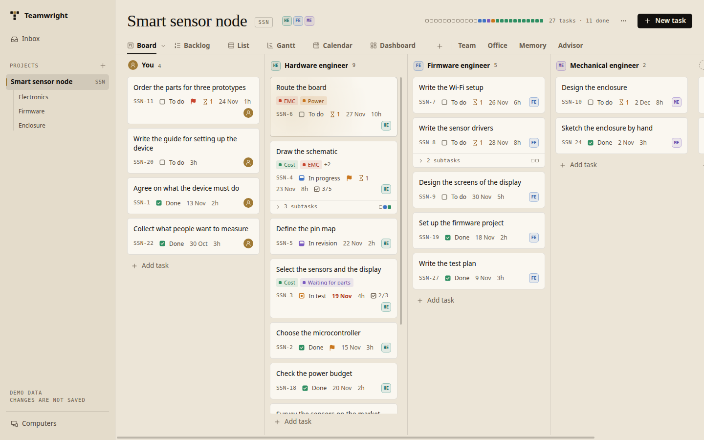
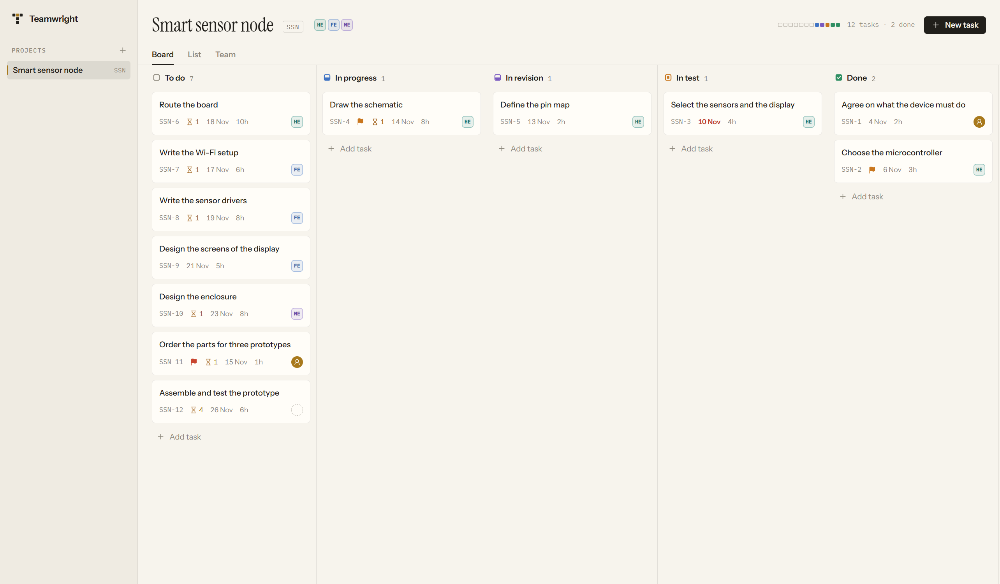
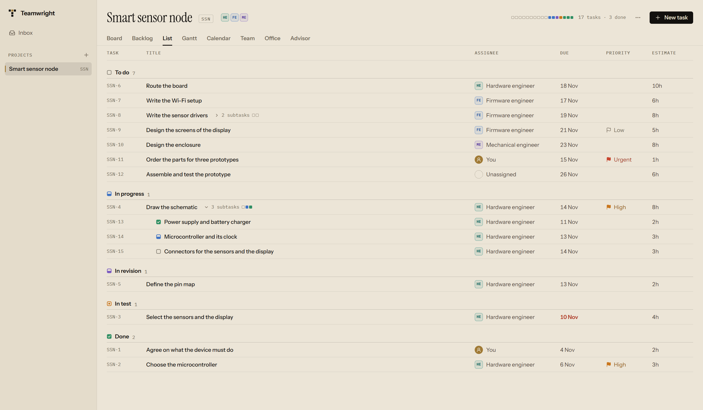
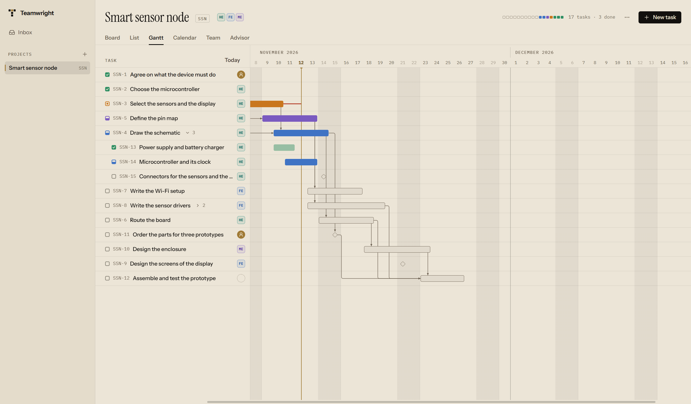
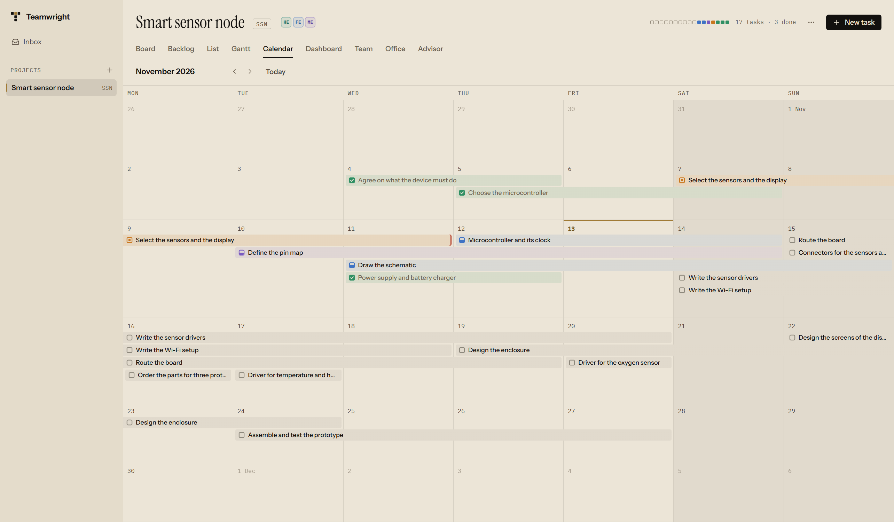

# Views and areas

This page explains the tabs under the name of a project: the views that show
your tasks, how to arrange them, and the kinds of view you can add. Areas are
described in [your first project](first-project.md#areas).

The row of tabs has two parts. First come the **views**, which show the
tasks of the project and are yours to arrange. After a thin divider come the
**places**: Team, Office, Memory and Advisor. They are about the project
itself and are always there.

A new project starts with the views its [template](first-project.md#the-templates)
gives it. The most common are Board, Backlog, List, Gantt, Calendar and
Dashboard.

## Arranging views

- **Add a view** with the **+** at the end of the views. Choose a kind; each
  line says what it is for. The new view opens with its name ready to be
  typed over; press Enter to keep it. A project can have as many boards,
  lists, Gantt charts and calendars as you like, and one backlog and one
  dashboard. Those two are not offered while the project has them.
- **The menu of a view** opens from the small arrow at the end of its tab,
  or with a right click on the tab. It has *Rename*, *Filter*, *Group by*,
  *Move left*, *Move right* and *Remove view*. A double click on a tab
  renames it, and you can drag a tab to another place. The last view of a
  project cannot be removed.
- **When the row is full**, the views that do not fit the window are behind
  *N more* at the end of the row. The view that is open always keeps its tab.

Views are kept with the project. Which view is open is remembered on this
computer.

## Filtering

*Filter* in the menu of a board, a list, a Gantt chart or a calendar says
which tasks it shows:

- **Whose tasks:** everybody's, yours, those of one member, or those given
  to nobody. *Hide finished tasks* hides tasks whose status means done,
  whatever the status is called.
- **With the tag:** only tasks with one tag.
- **With the field:** only tasks with one choice of a choice field, or *yes*
  or *no* of a yes-or-no field. A box nobody ticked counts as *no*.

A task stays in the view when one of its subtasks passes the filter, and its
subtasks always stay with it. A filtered view has a small mark on its tab and
a line at its top that says what it shows, for example "Shows the tasks of
Firmware engineer". *Show every task* clears the filter. A task you add
while a view shows one member's tasks, or yours, is given to that member or
to you, so that it stays in the view. When a member leaves the team, a view
that showed only their tasks shows everybody's again.

## Grouping

*Group by* is in the menu of a board or a list. It offers *Status*,
*Assignee*, *Priority*, *Area*, *Tag* and *Sprint*. On a board, the lanes
are the groups. In a list, the groups are headed sections that fold.

- A task with several tags stands under each of its tags.
- On a board, drag a card to another lane to change what the lane stands
  for: its assignee, priority, area or sprint. Dragged from the lane of one
  tag to another, a card gets the new tag and loses the old one. Dragged to
  *No tag*, it only loses the tag. A sprint that is over takes no card.
- [Limits](first-project.md#limits) show only when the board is grouped by
  status. In the other lanes each card says its own status.

Grouping was tested and seen in the demo. It has not been run in the
installed program.

## The board

One lane for every status. Drag a card to another lane to change its status,
or up and down to change its place. An overdue date is shown in red. The
number next to the name of a status counts the tasks in its lane. Subtasks
are not counted: they travel with their task.

A card shows the number of the task, its tags, its checklist progress
(`3/5`), the tasks it waits for, its due date and estimate, and who it is
given to. A card has a brass mark while a specialist works on it.

<picture>
  <source media="(prefers-color-scheme: dark)" srcset="../screenshots/board-dark.png">
  
</picture>

This picture was taken before tags and checklists. A card today also shows
those.

## The list

One table of all tasks, grouped by status unless you chose another group,
with the subtasks of a task set in under it.

<picture>
  <source media="(prefers-color-scheme: dark)" srcset="../screenshots/list-dark.png">
  
</picture>

## The Gantt chart

The plan against time: one row for every task, in the order of the schedule,
and a bar from its start to its due date.

- A bar is hollow while the work has not started. It takes the color of its
  status once it has, and is quieter when the task is done.
- A task with only a due date is a small mark on that day. A task with only
  a start fades out to the right. A task without any date has a row and no
  bar.
- A line leads from a task to each task that waits for it. The line is red
  when the dates contradict it.
- A thin red line behind a bar shows how late the task is. The line in brass
  is today, and *Today* in the corner scrolls back to it.
- Drag a bar to move the task. Drag one of its ends to change only its start
  or only its due date. Escape puts the bar back.
- Press a bar or the name of a task to open it.

### Planned against actual

The switch *Actual* in the corner shows what really happened under the plan,
and the view keeps it on. A thin line under a bar runs from the day work
began (the task first went into a status that is under way, in review or
done) to the day it was finished, or to today while work goes on. The days
past the due date are hatched. After the bars, a few words say how it went:
"began 1 day late", "finished 2 days late", "3 days past due", "not begun, 2
days late", "opened again" for a task that was finished and opened again, and
"no planned dates" for a task that was worked on without a plan.

Teamwright reads this from the record of changes it keeps, by the meaning of
the statuses, never by their names. It was tested and seen in the demo
only. It has not been run in the installed program.

<picture>
  <source media="(prefers-color-scheme: dark)" srcset="../screenshots/gantt-dark.png">
  
</picture>

## The calendar

One month at a time. A task lies on the days from its start to its due date,
and a task with one date lies on that day. The arrows go to the month before
and after, and *Today* comes back. A day with more than six tasks gets a note
such as "+2 more", which opens the list of its tasks. Tasks without any date
are not on the calendar: their number is shown at the top right.

<picture>
  <source media="(prefers-color-scheme: dark)" srcset="../screenshots/calendar-dark.png">
  
</picture>

## The table

The *Table* view shows every field of every task as a column, and you can
change a value in place. The *Columns* menu at the top right turns columns on
and off. After the columns every task has (Task, Title, Status, Assignee,
Priority, Points, Estimate, Start, Due, Sprint, Area, Tags, Waits for) come
the [custom fields](tasks.md#custom-fields) of the project, one column each.
A table that never chose its columns shows all of them, also a field added
later. Once you turn a column on or off, the table keeps your choice, and a
field added later stays hidden until you turn it on.

## Other kinds of view

*Add a view* offers more kinds. The first group, "Looks at the tasks", is:

| Kind | What it is for |
|---|---|
| Board | A lane for every status, or another group |
| List | Every task in one table, in sections |
| Table | Every field a column, to change in place |
| Gantt | The plan against the days |
| Calendar | A month with the tasks on their days |
| Timeline | Who works on what, along the days |
| People | Each person and their work |
| Workload | How much lies on each person, week by week |
| Mind map | The project as a tree |
| Gallery | Tasks as pictures in a grid |
| Activity | Everything that happened, newest first |

The second group, "Pages", is:

| Kind | What it is for |
|---|---|
| Doc | A page of writing kept with the project |
| Files | What lies in the folders of the project |
| Whiteboard | A free ground for notes and sketches |
| Form | A form that makes a task |
| Embed | A page from elsewhere, inside the project |
| Chat | Talk with the team in one place |
| Report | One page about the project, to hand to somebody |

A view of each of these kinds was added and opened in the installed program
without an error, and a page written in a Doc view was kept after the program
was started again. Each was looked at closely only in a browser on the demo.
These were never tried in the installed program: dropping a picture on a
Gallery card, a page in an Embed view, printing a Report, opening a file from
the Files view, and content that arrives from another computer while a view
is open.

The Report view is described in
[the dashboard and the reports](dashboard-and-reports.md#the-report-view).
