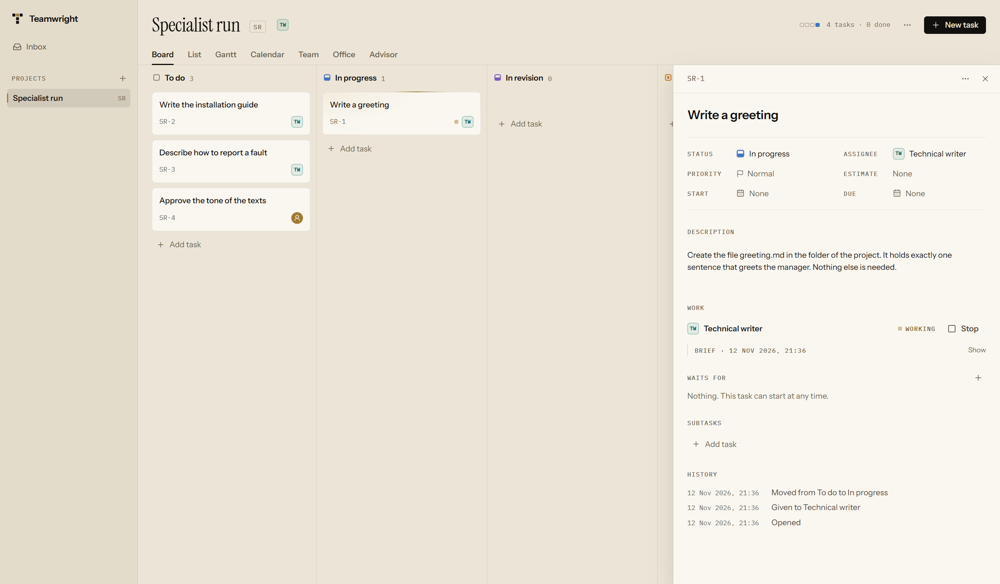
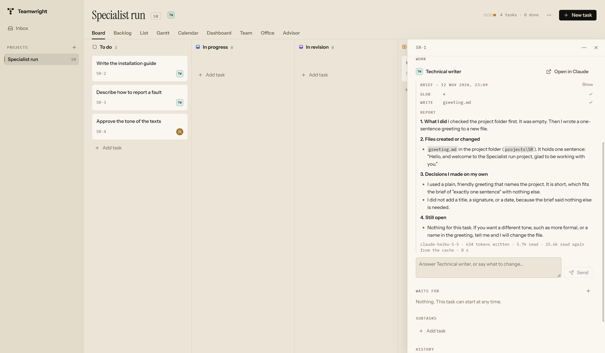
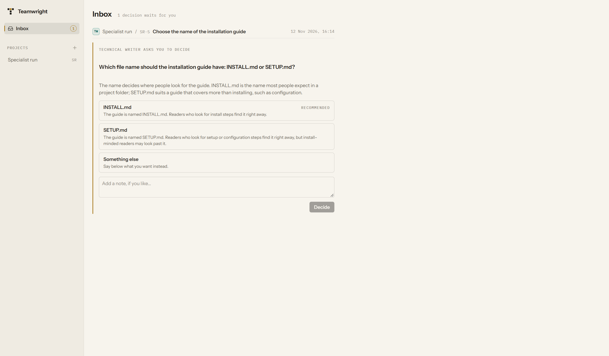
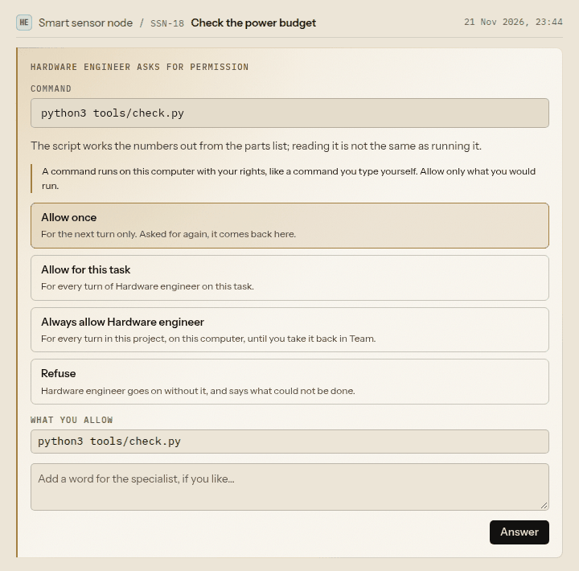
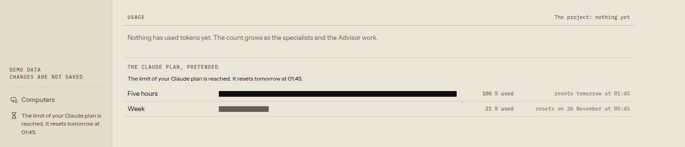
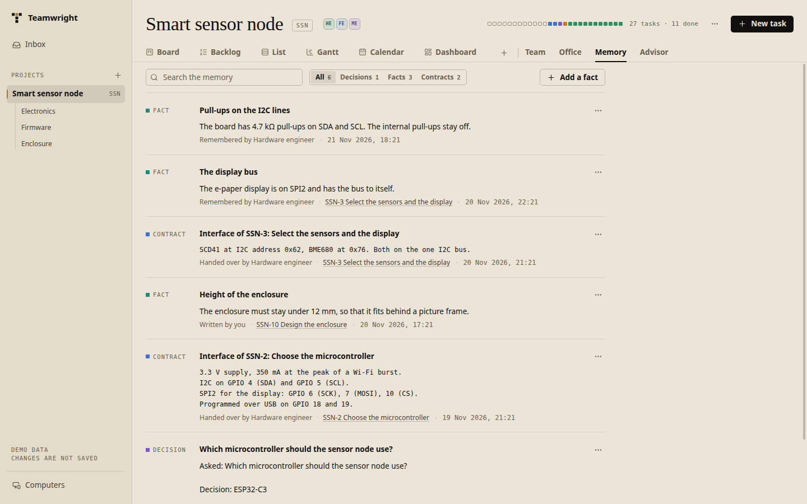
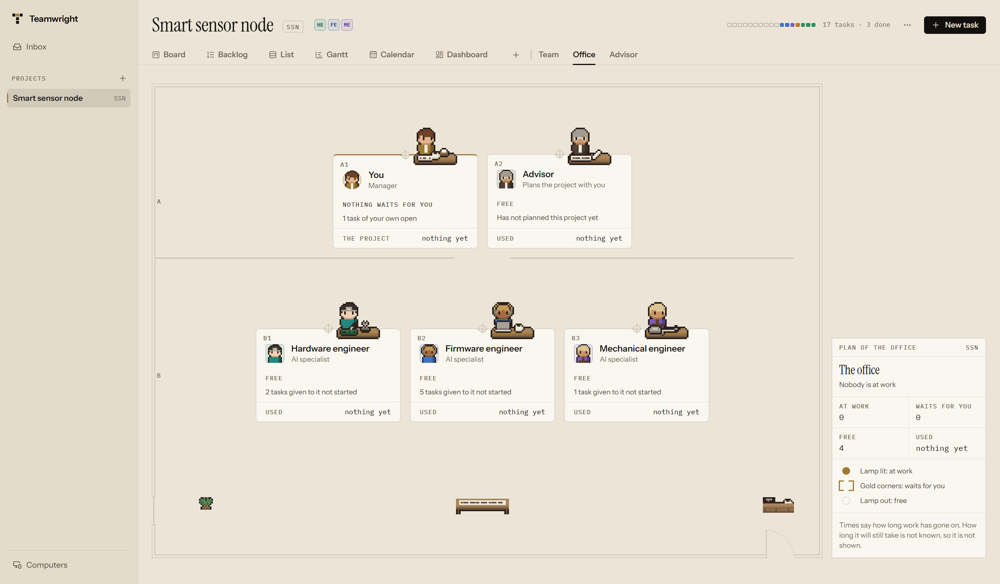
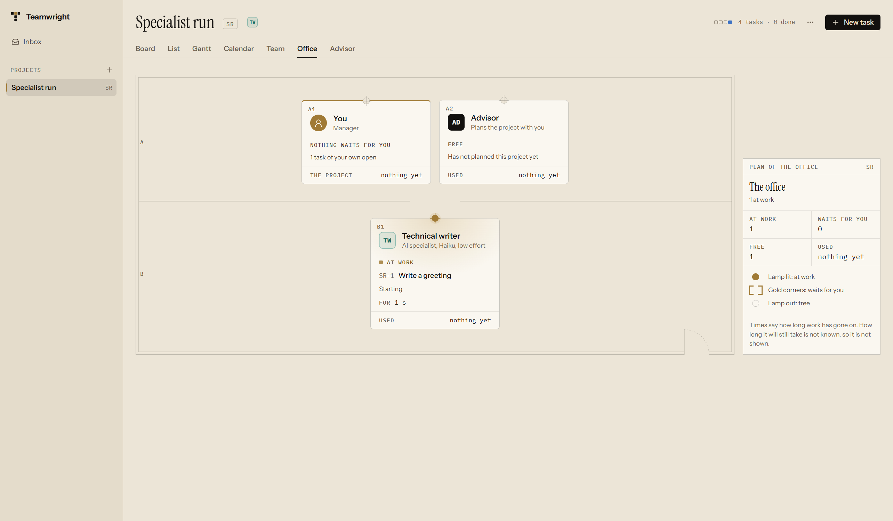

# Work

This page explains how a specialist carries out a task, how you follow it and
answer it, how specialists hand work to each other, what the memory of a
project is, and how the office shows who is busy.

An AI specialist is a session of Claude Code that runs on your computer under
your own account. Teamwright starts it, shows what it does, and keeps the
record. You need Claude Code installed and signed in (see
[what you need](what-teamwright-is.md#what-you-need)).

## Starting work

1. Open a task that is given to an AI specialist.
2. In *Work*, press *Start work*.

The specialist gets a brief: the task and its description, what it is a part
of, its parts, the tasks it builds on and how they stand, what those tasks
handed over, what the memory of the project says that belongs to it, when it
is due, and what you expect back. The task moves to the first status in which
work is under way.

A specialist works on one thing at a time. While it works it cannot be asked
something else and cannot be removed from the team, and its task and its
project cannot be deleted or put away. Stop it first.

## Following it

The panel of the task shows every step as it happens: what the specialist
writes, and which files it reads and changes. The card of the task carries a
brass mark while somebody works on it, and the *Team* place says what each
specialist is working on. *Stop* ends the work at once.

<picture>
  <source media="(prefers-color-scheme: dark)" srcset="../screenshots/specialist-working-dark.png">
  
</picture>

## The report and your answer

A specialist ends with a report: what it did, which files it created or
changed, what it decided on its own, and what is still open. The task moves
on to the first status in which work is checked. Under the report are the
model, the tokens the turn used and how long it took.

<picture>
  <source media="(prefers-color-scheme: dark)" srcset="../screenshots/specialist-report-dark.png">
  
</picture>

Write under the report to accept the work, to correct it or to ask for more.
The specialist goes on in the same session, so it remembers what it did, and
the task goes back into work until it reports again. Teamwright never calls a
task done by itself. That is yours to say: move the task to a status that
means done.

**Ask something.** *Ask something* in the menu of a specialist in the *Team*
place opens a conversation that is not about a task.

**Where the work is.** A specialist works in the work folder of its project:
by default `Teamwright\<key of the project>` in your documents. What it
produces are files in that folder, yours to open with any program.

**When something goes wrong.** A turn that fails says why in words, for
example that Claude Code is not signed in. Answer it to try again. If you
close Teamwright while a specialist works, the specialist is stopped, and its
turn says so the next time you look.

## The inbox

The *Inbox*, at the top of the sidebar, holds what waits for you in all of
your projects: the questions your specialists asked instead of guessing, and
what an Advisor asks or proposes. The number next to it says how many there
are, and what has waited longest comes first.

A specialist does not guess at a choice that is yours: one that changes what
is built, what it costs or when it is ready. It stops and asks. Its question
shows in the panel of the task and in the inbox: what it wants to know, why it
matters, the options with what each leads to, and the one it recommends. Pick
an option and add a note if you like, or pick *Something else* and say what
you want in your own words. Then press *Decide*, and the specialist goes on
with your answer. Until then the task stays in work, its card carries a
hollow brass mark, and the specialist is free for other work.

<picture>
  <source media="(prefers-color-scheme: dark)" srcset="../screenshots/specialist-inbox-dark.png">
  
</picture>

The line above a question names the project and the task, and the title of
the task leads to it. What an Advisor wants needs more room: *Open* leads to
its page.

## When a specialist asks for a permission

A specialist reads and writes in the folders of its project and does nothing
else on its own (see [safety and trust](safety-and-trust.md)). When it needs
to run a command, such as a build or a test, or to read a page on the web, it
does not work around the rule. It asks you, and its turn ends. The request
waits in the *Inbox*, next to the questions, the oldest first.

A request says who asks, for which task, and exactly what it wants, in one of
three kinds: *Command* (one command line), *Commands that start with* (a
program and its subcommand, such as `cargo build`) or *Web domain*. Under it
stands the reason in the specialist's own words. For a command there is also
this sentence: *A command runs on this computer with your rights, like a
command you type yourself. Allow only what you would run.* Read it.

1. Open the *Inbox* and read what is asked and why.
2. Pick an answer:
   - *Allow once*: for the next turn only. If the specialist needs it again,
     it asks again.
   - *Allow for this task*: for every turn of that specialist on this task.
     It is offered only when the request is about a task.
   - *Always allow* the specialist: for every turn in this project, on this
     computer, until you take it back.
   - *Refuse*: the specialist goes on without it and says what could not be
     done. It is told not to try another way.
3. If you allow, look at *What you allow* before you press. You may edit it.
   For a command of more than one word, *This command only* and *Every …
   command* narrow or widen it to the program and its subcommand. Teamwright
   checks what you typed again and refuses what could never be allowed (see
   [what can never be allowed](safety-and-trust.md#what-can-never-be-allowed)).
4. Add a word for the specialist if you like, and press *Answer*.

Your answer starts a new turn of the same conversation, which says in words
what was allowed, for how long, or that it was refused. A notification of the
kind *Someone waits for you* says "*name* asks for permission", if you allowed
notifications.

A permission holds only on the computer where you gave it, because a command
is a command of one computer. On another computer the specialist asks again.

**What stands.** The *Team* place lists, under *Permissions*, everything you
allowed for a task or always, with the specialist it is for, how long it
holds, and *Take back*. Press *Take back* and the next turn starts without it.
A permission you allowed once is gone with its turn and is not listed.

Note: permission requests were tested at every layer and seen in the demo,
where a task whose title starts with *Check*, *Test*, *Measure* or *Run* makes
the pretended specialist ask. A real specialist has never asked, and no
command has ever run on a permission in the installed program. The setting
that keeps even harmless commands from reading outside the folders was taken
from the documentation of Claude Code and has never been seen in a run.

## The limit of your Claude plan

Your Claude plan allows a certain amount of work in five hours and in a
week. When you reach the limit, every specialist stops, at once, whatever it
was doing. This is what you see.

- **A line at the foot of the navigation**, under *Computers*: *The limit of
  your Claude plan is reached. It resets at 22:40.* It is plain and not lit:
  nothing waits for you, the work only waits for the time. When Teamwright
  does not know when it resets, the line says *When it resets is not known.*
- **The turn that was stopped** says *The limit of the Claude plan was
  reached.* It is not shown in red, because nobody failed. The task stays in
  work, and nothing is lost: what the specialist had done is kept, and it
  goes on in the same conversation.
- **One notification**, of the kind *Someone stopped*: *The limit of your Claude plan
  is reached*, with the time it resets and that no new work starts before
  then. You get one, however many specialists stopped. You get one more when
  the limit has reset.
- ***Try again*** under the stopped turn. Press it after the reset and the
  specialist goes on where it stopped.

You may also press *Start work* or *Try again* before the reset, because you
may know better: you may have upgraded the plan, or the reset may have come
early. The words beside the button say that the work will most likely stop
again at once. If it goes through, the limit was over.

The limit is a fact about the Claude account signed in on this computer, so
another computer, which may use another account, does not show it. The
[coordinator](coordinator-and-budgets.md#the-coordinator-and-the-limit-of-your-plan)
starts nothing while it is reached. The Usage part of the
[Dashboard](dashboard-and-reports.md#the-dashboard) shows the plan in more
detail.

Note: the limit of the plan was built after an evening on which eight
specialists stopped at once, and it is tested with recordings and seen in the
demo, which can pretend that the limit is reached. It has never been seen with
a real Claude Code: the program was not signed in on the computer where it
was built. The words Claude Code uses for its limit change with its versions;
one Teamwright does not recognise shows as an ordinary failed turn with that
sentence.

## Handoffs and messages between specialists

Specialists never read each other's conversations. They hand work over
through Teamwright.

**A handoff** belongs to a task. When a specialist finishes, it can hand the
result over: a summary, an interface contract (text, such as which pin does
what), and the files that must exist in the folder of the project. Teamwright
checks that the files are there. A task that builds on it starts with the
latest handoff of every task it waits for in its brief. You read a handoff in
the panel of the task.

**A message** goes from one specialist to another specialist of the same
team. It is a *question* or a *note*. It does not start the receiver; it
comes with the receiver's next turn, whatever starts that turn. A specialist
sends at most five in a turn. You read all of them in the *Team* place, under
*Between teammates*, with who wrote to whom, when, and whether it waits or was
read. Messages to people are not possible: a person has no session.

A specialist may describe its result in its report and not hand it over.
Its instructions ask it to hand over, and nothing forces it.

Handoffs and messages were tested with recorded tool calls and seen in the
demo. They have not been seen with a real specialist or in the installed
program.

## The memory of a project

The *Memory* place keeps what the team has decided and agreed, so that you do
not retell it, and so that a specialist can find it.

An entry is a **decision**, a **fact** or a **contract**, with a title and a
text, the task it belongs to if any, and where it came from. Entries come
about in four ways:

- When you answer a question of a specialist, the question and your answer
  become a decision of the task, by themselves.
- When a handoff has an interface contract, the contract becomes the contract
  of its task. A newer one replaces the older.
- A specialist remembers a fact, up to three in a turn.
- You press *Add a fact*, give it a title and write "What is true".

An entry never changes in place. Changing one makes a newer entry that
replaces it, and the older one stays readable: *Show 1 entry newer ones
replaced* at the foot shows them. The menu on an entry (*Change*, *Remove*)
lets you correct or remove one. The buttons *All*, *Decisions*, *Facts* and
*Contracts* filter the list, and the field *Search the memory* finds entries
whose words begin with what you typed.

Specialists search the memory themselves, and the brief of a task carries
what belongs to it, at most eight entries. They are told to search the memory
before asking you.

Memory was tested at every layer and seen in the demo. The program's own tool
for the specialists answered a search and a remembered fact in a test. It has
never run with a real session of Claude Code.

## The office

The *Office* tab draws your project as a workshop seen from above. You and
the Advisor sit at the front of the room, where the plan is made. Every
member of the team has a bench on the floor, with a reference such as *B2*. The
arrangement follows from the size of the team and of the window: you do not
arrange it.

<picture>
  <source media="(prefers-color-scheme: dark)" srcset="../screenshots/office-dark.png">
  
</picture>

A lamp hangs over every bench. It is lit only where a specialist or the
Advisor is working. A bench that waits for you is held by four gold corners,
like a waiting card on the board. The words on the bench always say the same
as the light, so the office reads in a picture and with motion turned down.

<picture>
  <source media="(prefers-color-scheme: dark)" srcset="../screenshots/specialist-office-dark.png">
  
</picture>

| What the bench says | What it shows |
|---|---|
| *At work* | The task, or *A question of yours*; the last thing done; how long the work has gone on; and the size of the task, if it has one |
| *Waits for you* | The task, and the decision it asks of you. For the Advisor: its questions, or its proposal |
| *Free* | How many of the tasks given to it have not started |
| *Person* | How many of the tasks given to them are not finished |

The last line of a bench is what that specialist has used in this project so
far, in tokens. A turn's tokens are known only when it ends. The office shows
no time left, because Teamwright does not know how long a task will take.

**Press a bench** to go on: a specialist at work or waiting opens its task, or
its conversation; a free specialist opens a conversation; the Advisor opens
its page; your own place opens the inbox. With the keyboard, Tab moves from
bench to bench and Enter presses.

Every place has a person drawn in pixels at a desk. What each wears and has
on the desk tells its role: a software or firmware specialist wears
headphones, a hardware one a loupe, and so on. Teamwright chooses the figure
from the words of the member's name or its responsibility, and each member
looks the same every time. The people work, wait with a hand raised, sit at
ease, and now and then walk to the table with the plan or the coffee corner. It
is calm on purpose, and if your system asks for less motion, nobody walks.

A specialist at work at its desk was seen in the installed program. Waiting,
walking and the small things were seen in a browser on the demo only.
